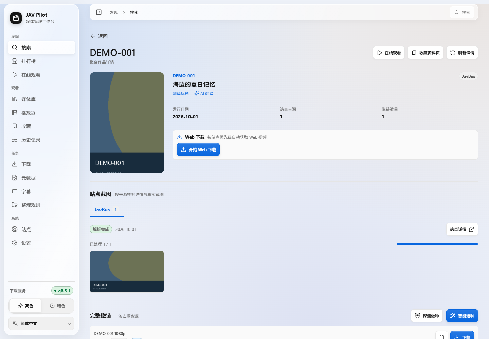
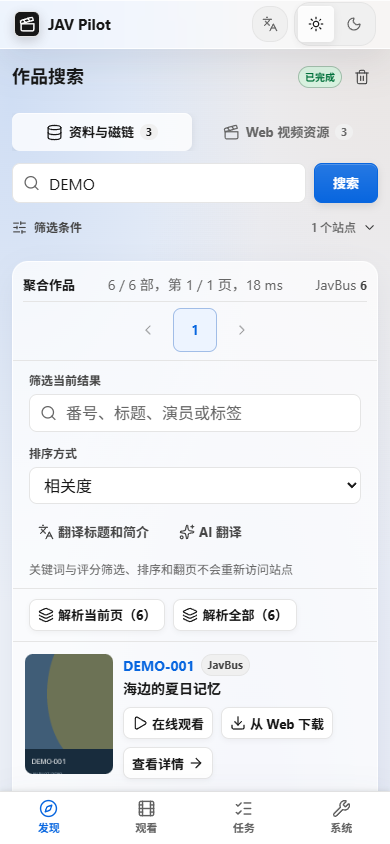

# 使用指南

## 在线观看与收藏

从侧栏进入「在线观看」，可浏览已在「站点」中启用的 JableTV、MissAV、123AV。聚合检索按站点各显示一行，包含命中数量、版本概况和独立的检索状态；点击「查看结果」进入该站点的作品网格。选择单个站点时，直接在网格中浏览、筛选和滚动加载更多结果。搜索结果卡片、排行榜作品卡片和作品详情页上的「在线观看」会自动按番号检索启用站点。

原片、中文字幕、无码流出等版本各自保留原站作品地址，选择哪一版就解析哪一个入口。打开站点作品后，可查看解析后的作品信息或点击「开始播放」；网格中的「应用内播放」可直接进入播放器。播放器使用应用自定义控制，支持进度、倍速、字幕和全屏；未提供画中画按钮。可用主清单提供多个画质时可选择清晰度。访问验证由现有后台浏览器框架处理，单个站点失败不会影响其他站点。无法通过的验证、限流或超时会显示重试入口；上游线路失效时可「重新解析」或返回结果切换站点。

收藏分为三种，彼此独立：

| 类型 | 打开后的行为 | 收藏位置 |
| --- | --- | --- |
| 资料页 | 返回应用内的聚合作品资料 | 作品详情页 |
| 站点作品 | 打开应用内的站点作品页 | 站点作品网格或作品页 |
| 播放链接 | 自动解析当前有效线路并播放 | 站点作品页或播放器 |

播放链接收藏保存稳定的作品入口和版本信息，不保存会过期的 CDN 地址、Cookie 或播放密钥。收藏保存在数据目录的 `bookmarks.sqlite3`，可跨浏览器使用；收藏页支持按类型和关键词筛选、取消收藏。播放会话只存于内存，离开播放器后按下文的暂停保留周期释放；服务重启或链接失效后重新解析即可。媒体请求通过应用内的站点白名单代理发送，不需要在浏览器配置第三方跨域访问。

[返回 README](../../README.md)

## 1. 检查站点能否访问

打开“站点”，在“站点诊断”中各填一个确定存在的 JAV 番号和 FC2 番号，点击“测试全部站点”。每个站点按配置、DNS、连接、搜索、详情、图片逐项显示结果：

- 停在 DNS 或连接：网络问题，通常需要设置代理，见[常见问题](faq.md#所有站点都连不上)。
- 停在搜索或详情：站点可能改版、要求人机验证或暂时不可用，可以先在同一页面停用它。

填写的番号会被记住，后台定期用它们复查站点状态。默认启用 JavBus、JavDB、FC2（资料与磁链）以及 JableTV、MissAV、123AV（Web 下载）；其他来源可在同一页面启用，各站点的差别见[来源说明](sources.md)。

## 2. 连接 qBittorrent（可选）

与 JAV Pilot 一起部署的 qBittorrent 按[安装指南](getting-started.md#同时部署-qbittorrent-或-jackett)设置即可。连接已有的 qBittorrent 时，在“设置 → qBittorrent”中填写：

- **Web API 地址**：qBittorrent 与 JAV Pilot 在同一台主机时填 `http://host.docker.internal:<WebUI 端口>`。不要填 `localhost`，在容器里它指向 JAV Pilot 自己。
- **账号、密码**：qBittorrent WebUI 的登录信息。
- **JAV 下载分类**：新任务都放进这个分类（默认 `jav`），自动整理也只处理这个分类。
- **JAV 下载暂存目录、完成整理目录**：填 **qBittorrent 看到的路径**，不是宿主机路径。完成整理目录留空时不自动移动。

同一个宿主机目录必须同时挂载给 qBittorrent 和 JAV Pilot。例如 qBittorrent 容器把宿主机的 `/volume1/downloads` 挂载为 `/downloads`、`/volume1/media` 挂载为 `/media`：

| 用途 | 宿主机目录 | “设置”中填写 | `.env` 中填写 |
| --- | --- | --- | --- |
| 下载暂存 | `/volume1/downloads/jav` | 暂存目录 `/downloads/jav` | `JAV_PILOT_QB_STAGING_HOST_PATH=/volume1/downloads/jav` |
| 媒体库 | `/volume1/media/JAV` | 整理目录 `/media/JAV` | `JAV_PILOT_LIBRARY_HOST_PATH=/volume1/media/JAV` |

qBittorrent 直接安装在宿主机上时，“设置”中填写的就是宿主机目录本身；“应用内媒体库挂载”保持 `/media/JAV`。修改 `.env` 后执行 `docker compose up -d` 生效。

## 3. 搜索并下载

1. 在“搜索”中输入番号或关键词。输入完整番号可以直接定位作品；打开“精确匹配”只保留番号前缀完全一致的结果。“解析磁链”会逐个打开作品详情获取磁链，关闭后搜索更快，磁链留到详情页再加载。
2. 点击封面或标题打开详情，核对资料和各站截图后选择下载方式：
   - 磁链右侧的“下载”：加入 qBittorrent。
   - “开始 Web 下载”：从视频站下载，默认选择 4K 以内的最高画质，版本按原片、中文字幕、无码的顺序挑选。
3. 在“下载”页查看进度。完成后影片进入媒体库，NFO 和图片自动生成；缺失的可以在“媒体库”一键补全。

搜索页切换到“Web 视频资源”可以按番号前缀批量查找视频站上的作品，勾选后一次提交下载，也可以保存成批量规则反复使用。

手机上打开同一个地址即可，布局会自动适配：

## 4. 调整默认值（可选）

“默认参数”集中设置默认搜索站点、结果数量、Web 下载的画质上限和版本顺序、元数据自动补全、翻译和 AI 翻译。各页面还会记住你在这台设备上最近一次使用的条件。

## 5. 中文字幕（可选）

影片完成元数据补全后，JAV Pilot 会按番号从迅雷字幕和 SubtitleCat 查找外挂中文字幕，把最合适的一份保存在影片旁边，命名为 `<影片文件名>.zh-CN.srt`（繁体为 `.zh-TW`，扩展名沿用字幕原格式），Jellyfin、Emby、Kodi 等播放器会自动识别。

- 挑选时先排除番号不符、与影片时长明显不符的字幕，再优先人工字幕、时长吻合、字形一致的字幕；下载后还会确认内容确实是中文、时间轴没有超出影片。
- 以下情况会自动跳过：影片旁已经有字幕（包括你自己放的）、分段影片（CD1、CD2 等）、Web 下载的中文字幕版本。
- “字幕”页列出所有任务及状态；“为缺字幕的作品获取”会为媒体库中还没有字幕的影片批量查找。找不到字幕的作品会在 7 天和 30 天后各自动重查一次。
- 媒体库的“异常”筛选中选择“缺少字幕”可以找出没有字幕的作品；点击行末的字幕按钮可以查看候选、重新获取、换用另一份或删除字幕。
- JAV Pilot 只会覆盖或删除自己写入且未被修改过的字幕文件，不会动你放进去的字幕。

字幕字形（简体或繁体）、是否自动获取、是否使用机器翻译字幕在“设置 → 工作流默认参数 → 字幕”中设置；字幕来源在“站点”页启用或停用。
## 本地观看与播放记录

媒体库中可用的作品可以直接点击“本地播放”。播放器支持拖动、快进退、倍速、全屏和多文件切换；在线播放与本地播放共用独立的“播放器”入口，离开播放页立即暂停并保存进度，播放器保留约 30 秒，期间返回无需重新加载；超过 30 秒释放播放资源，同时保留暂停帧和进度条；再次返回保持暂停，点击继续播放才重新加载。离页期间完成的解析也不会自动播放。

“历史记录”分为播放记录和搜索记录。播放记录保存作品入口、已播放时长、总时长及最近观看时间，点击“继续播放”会恢复进度；在线作品会重新解析有效线路。本地进度关联实际文件，文件被替换后不会误用旧进度。

本地播放由浏览器直接解码，H.264/AAC MP4 兼容性最好；当前不提供实时转码。不支持的编码会在播放器中提示。

媒体库按番号前缀展示目录，例如 ACZ-001 与 ACZ-002 都收进 ACZ。目录封面由默认排序前 9 张有效竖版海报拼成九宫格；封面下方的编辑按钮可以自选最多 9 张海报并保存顺序，或恢复默认。进入目录后，每部作品使用自己的海报，点击进入本地详情页，提供播放、补全资料和字幕操作。列表随滚动自动加载。详情与目录页统一在左上角提供“返回”，恢复实际来源页面的筛选、已加载内容和滚动位置。

播放器支持电脑端单击画面播放或暂停、双击全屏；快进退按钮及左右方向键按 30 秒跳转。手机端双击画面左侧后退 30 秒、右侧前进 30 秒、中间播放或暂停；左右拖动画面可预览目标时间，松手后跳转（拖动一个画面宽度最多移动 120 秒，自动限制在影片时长内）；上下滑动不调整音量或亮度。应用不再提供音量、静音或亮度控件，请使用设备或浏览器的对应控制。手机播放横向视频时，全屏后会尝试锁定横屏，退出后释放方向锁；浏览器不支持或拒绝锁定时保持其默认方向。

HLS 播放保留最近 90 秒的回看缓冲，并预缓冲约 60 秒；媒体代理提供有大小及时间限制的会话缓存，本地文件允许短时私有缓存。小幅回退优先使用缓存，缓冲实际长度受浏览器、清晰度和设备内存影响。

播放器的倍速与清晰度菜单在画面内向上展开。字幕入口会自动列出影片旁的 SRT、VTT、ASS、SSA 外挂字幕，也可临时导入本机字幕；支持字幕开关、轨道切换、提前或延迟、字号、颜色、背景和垂直位置。样式保存在当前浏览器，时间偏移在切换作品时归零；ASS/SSA 使用文本时间轴，统一应用播放器中的显示样式。内嵌字幕和图片字幕暂不提取。

主导航按发现、观看、任务和系统分组；播放器未打开作品时显示最近观看与续播入口。本地播放记录使用归档横版海报，缺少横图时退回作品海报。

播放记录、搜索记录、收藏和媒体库均提供“批量管理”，可勾选或全选已加载的项目。移除历史或收藏需要确认，不会删除本地媒体或独立保存的文件进度。媒体库可批量获取字幕、按番号补全元数据和导出所选清单；选择目录时包含目录中尚未滚动加载的作品。字幕页支持批量重试和清除非活动任务记录，清除记录不会删除字幕文件。下载与元数据页面保留各自的批量处理工具。

手机端使用更紧凑的工具栏、返回按钮和底部导航，优先保留海报、影片与列表的展示空间。进度条跳转会立即显示目标时间并提示加载，不再等待媒体解码完成后移动光标。

123AV 可在站点中启用，用于在线观看聚合检索、分页网格、作品详情与推荐，并支持收藏及续播。其播放器数据从页面声明的 JSON 和 stream 接口读取，不执行来源脚本；轮换 CDN 仅授权给当前播放会话，仍限制为公网 HTTPS。验证域名与来源站点应使用同一代理出口。
