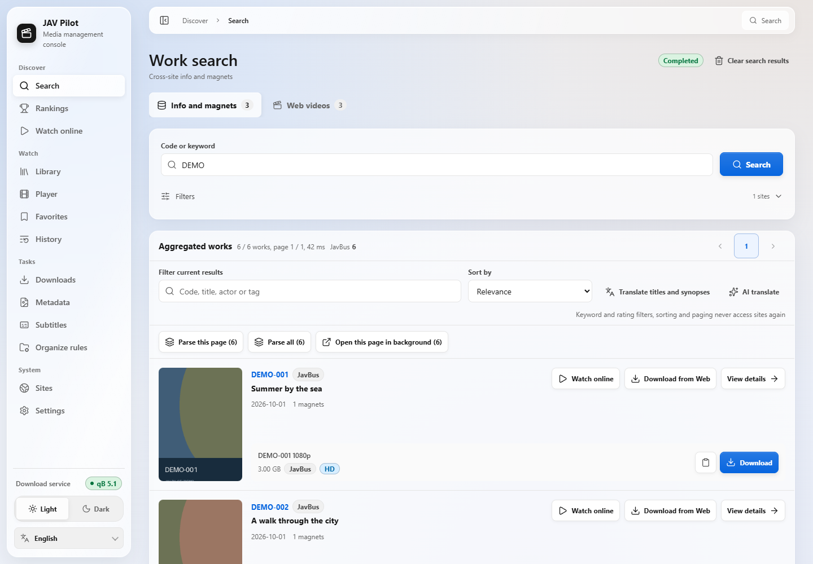
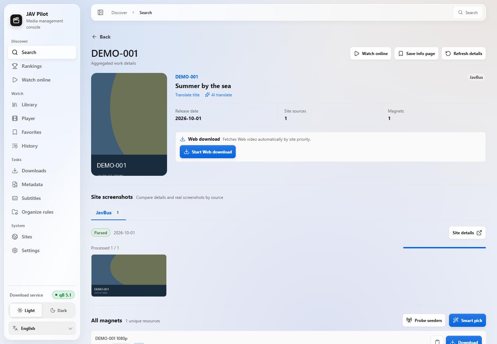
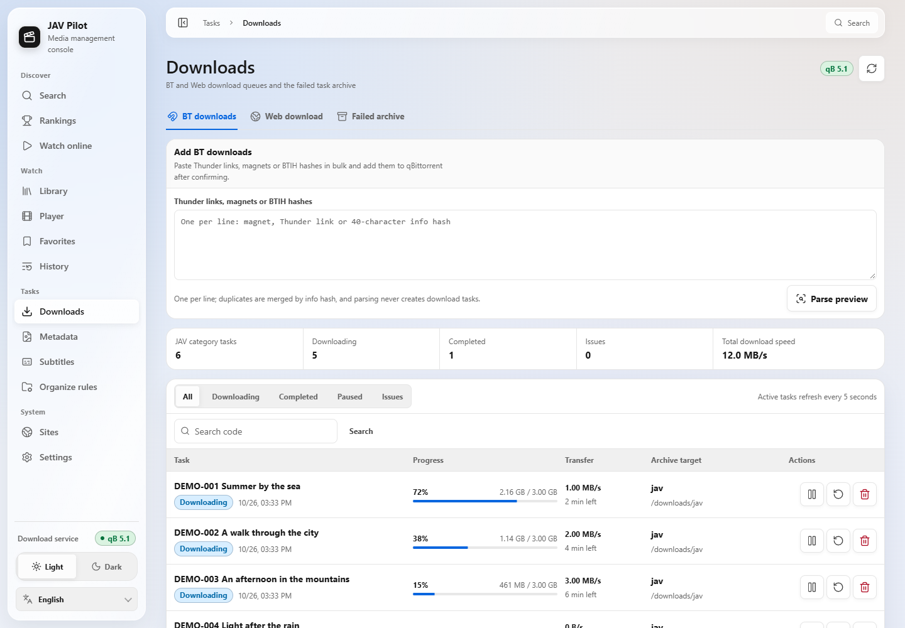
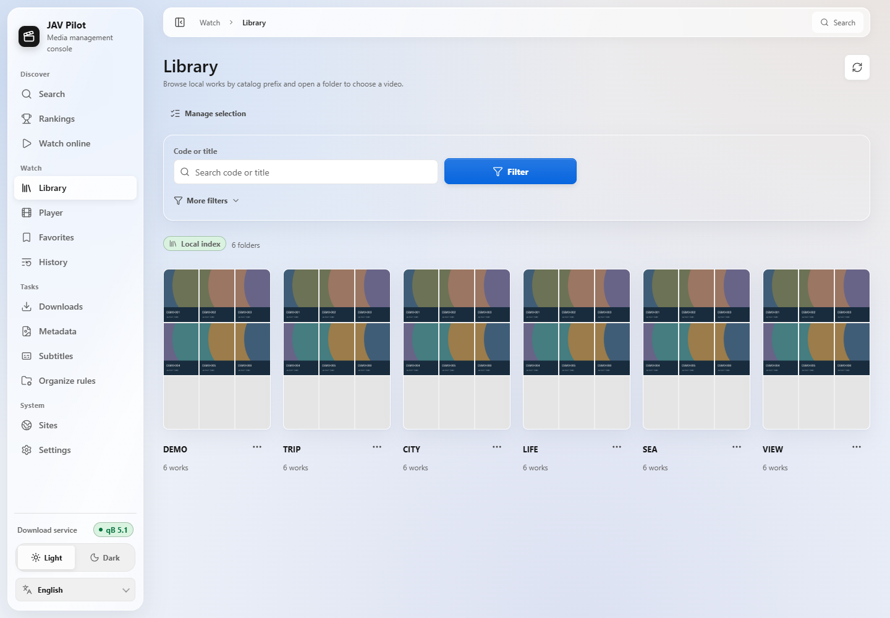
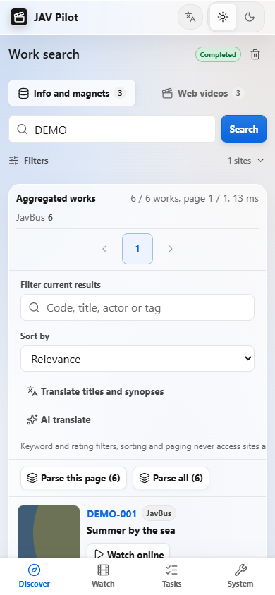
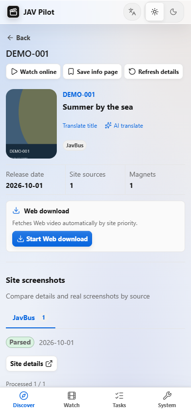
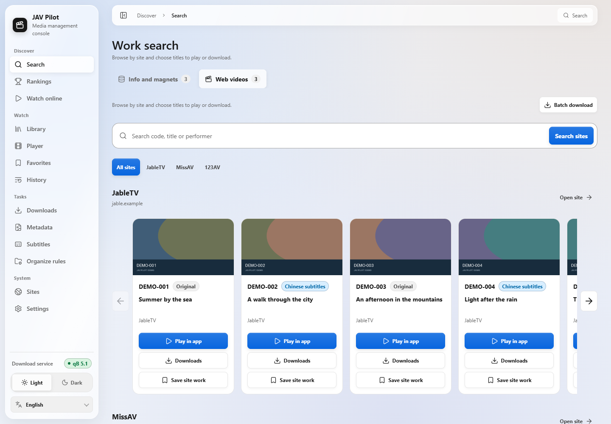
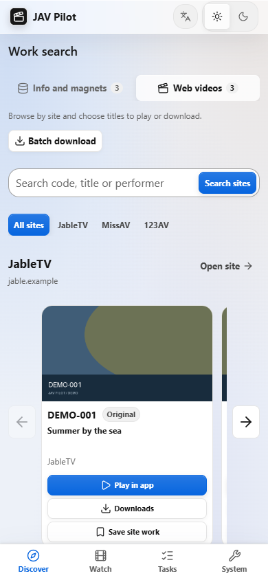
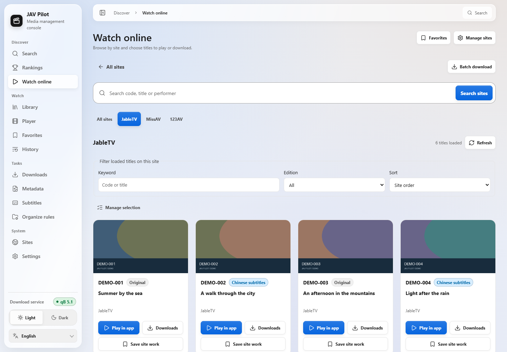
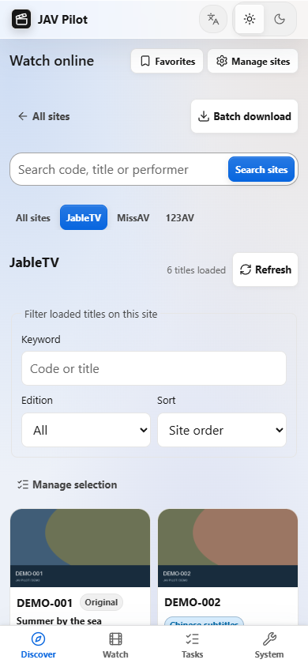

<p align="center">
  
</p>

<div align="center">

<a href="../../README.md">简体中文</a> |
<a href="README_zh-TW.md">繁體中文</a> |
<a href="README_en.md">English</a> |
<a href="README_ja.md">日本語</a> |
<a href="README_fr.md">Français</a> |
<b>Español</b> |
<a href="README_ru.md">Русский</a> |
<a href="README_ar.md">العربية</a>

<a href="https://hub.docker.com/r/drdon1234/jav-pilot"></a>
<a href="https://hub.docker.com/r/drdon1234/jav-pilot"></a>


<a href="../../LICENSE"></a>
<br>

<a href="../guide/getting-started.md">Instalación</a> |
<a href="../guide/usage.md">Uso</a> |
<a href="../guide/faq.md">Preguntas frecuentes</a> |
<a href="../guide/configuration.md">Configuración</a> |
<a href="https://github.com/drdon1234/JAV-Pilot/issues">Informar de un problema</a>

</div>

<br>

JAV Pilot es una aplicación de vídeo autoalojada en NAS, servidor u ordenador. Busca, mira en línea, descarga, organiza tu biblioteca y continúa la reproducción desde un mismo lugar. La biblioteca organizada también funciona con Jellyfin, Emby y Kodi. Accede desde el navegador del ordenador o móvil y guarda ajustes, historial y archivos en tu propio dispositivo.

> [!NOTE]
> La documentación detallada de la carpeta `docs/` solo está disponible actualmente en chino simplificado. La interfaz web está disponible en español y sigue por defecto el idioma del navegador y del sistema.


## ✨ Funciones

1. 🔍 **Buscar vídeos**: Encuentra fichas, enlaces magnet y vídeos en línea por código o palabra clave.
2. ▶️ **Ver en línea**: Explora y filtra por sitio, carga más al desplazarte y reproduce la edición elegida dentro de la aplicación.
3. ⬇️ **Gestionar descargas**: Descarga por magnet o desde sitios de vídeo, consulta el progreso, gestiona errores y evita duplicados.
4. 📚 **Organizar la biblioteca**: Gestiona archivos existentes y nuevas descargas y completa carátulas y metadatos para Jellyfin, Emby o Kodi.
5. 🎬 **Reproducir y continuar**: Subtítulos, velocidad, pantalla completa e historial tanto en reproducción local como en línea.
6. 💬 **Subtítulos chinos**: Busca o descarga subtítulos por lotes, elige otro candidato, importa archivos y ajusta su aspecto y sincronización.
7. ⭐ **Guardar y descubrir**: Guarda favoritos y explora clasificaciones de obras, actrices y categorías.
8. 🌐 **Traducir títulos**: Lee los títulos en el idioma de la interfaz o conecta tu servicio de traducción con IA.
9. 🔔 **Avisos y estado de sitios**: Recibe resultados de descargas y alertas de espacio o sitios no disponibles.
10. 📱 **Ordenador y móvil**: Interfaz adaptable con ocho idiomas y temas claro y oscuro.

## 🚀 Inicio rápido

Hay tres métodos de instalación. Para un primer despliegue se recomienda el método 1.

| Método | Caso de uso | Requisitos previos |
| --- | --- | --- |
| [Método 1: Docker (recomendado)](#método-1-despliegue-con-docker-recomendado) | NAS, servidor Linux o WSL2 en Windows | Docker y Docker Compose v2 |
| [Método 2: compilar desde el código fuente](#método-2-compilar-la-imagen-desde-el-código-fuente) | Modificar el código fuente o compilar una imagen propia | Docker, Git |
| [Método 3: sin Docker](#método-3-sin-docker) | Sin Docker disponible, o ejecución como servicio del sistema | Git, Python 3.11+, Node.js 24 |

### Método 1: despliegue con Docker (recomendado)

Utiliza la imagen publicada en Docker Hub. Solo se necesitan un archivo `docker-compose.yml` y un archivo `.env`.

> [!NOTE]
> La imagen solo es compatible con la arquitectura x86_64 (amd64). En Windows, ejecute los siguientes pasos dentro de WSL2.

**1. Elegir un archivo Compose**

Cada archivo Compose despliega los siguientes servicios:

| Archivo Compose | Servicios desplegados |
| --- | --- |
| `docker-compose.yml` | JAV Pilot |
| `deploy/docker-compose.jackett.yml` | JAV Pilot, Jackett |
| `deploy/docker-compose.qbittorrent.yml` | JAV Pilot, qBittorrent |
| `deploy/docker-compose.full.yml` | JAV Pilot, qBittorrent, Jackett |

qBittorrent es un cliente BitTorrent; Jackett proporciona la interfaz Torznab para Sukebei y Tokyo Toshokan. Los contenedores que se despliegan junto con JAV Pilot se llaman `jav-pilot-qbittorrent` y `jav-pilot-jackett`, por lo que no entran en conflicto con contenedores existentes del mismo tipo.

**2. Descargar el archivo Compose y la plantilla de configuración**

```bash
mkdir jav-pilot && cd jav-pilot
curl -fsSL -o docker-compose.yml https://raw.githubusercontent.com/drdon1234/JAV-Pilot/main/docker-compose.yml
curl -fsSL -o .env https://raw.githubusercontent.com/drdon1234/JAV-Pilot/main/.env.example
```

Si en el paso 1 eligió un archivo de la carpeta `deploy/`, sustituya `main/docker-compose.yml` en el segundo comando por su ruta (por ejemplo `main/deploy/docker-compose.full.yml`). El archivo guardado conserva el nombre `docker-compose.yml`.

**3. Completar `.env`**

Ejecute el siguiente comando para generar la clave de sesión y establecer la identidad de ejecución (`PUID` / `PGID`) en la cuenta actual:

```bash
sed -i "s/^JAV_PILOT_AUTH_SECRET=.*/JAV_PILOT_AUTH_SECRET=$(openssl rand -hex 32)/; s/^PUID=.*/PUID=$(id -u)/; s/^PGID=.*/PGID=$(id -g)/" .env
```

A continuación, edite `.env` (por ejemplo con `nano .env`):

- `JAV_PILOT_AUTH_PASSWORD`: contraseña de inicio de sesión, de al menos 12 caracteres. Obligatoria.
- `QBITTORRENT_PASSWORD`: necesaria si qBittorrent se despliega junto con JAV Pilot, de al menos 6 caracteres. Se convierte en la contraseña de la interfaz web de qBittorrent (usuario `admin`), y JAV Pilot se conecta automáticamente con las mismas credenciales.
- Carpetas: la biblioteca multimedia se encuentra por defecto en `media/` dentro de la carpeta actual. Para usar otra carpeta del NAS, modifique la sección «目录» (Carpetas) de `.env`.

**4. Iniciar el servicio**

```bash
docker compose up -d
```

El primer inicio descarga una imagen con Chromium y FFmpeg; el tamaño y el tiempo dependen de la versión y la red. Después, abra `http://<IP del host>:8766` en un navegador e inicie sesión con el usuario `admin` y la contraseña definida en el paso anterior.

Si falta un ajuste obligatorio, `docker compose` lo indica de forma explícita. Para otros problemas, consulte la [guía de instalación](../guide/getting-started.md#启动失败时). Para más información sobre qBittorrent y Jackett, consulte la [guía de instalación](../guide/getting-started.md#同时部署-qbittorrent-或-jackett) y los [indexadores de torrents](../guide/indexers.md).

### Método 2: compilar la imagen desde el código fuente

Compila la imagen localmente, para los casos en que haya que modificar el código fuente. Salvo el origen de la imagen, los pasos son los mismos que en el método 1.

```bash
git clone https://github.com/drdon1234/JAV-Pilot.git
cd JAV-Pilot
docker build -t jav-pilot:local .
cp .env.example .env
```

Complete `.env` como en el paso 3 del método 1, establezca `JAV_PILOT_IMAGE` en `jav-pilot:local` y ejecute `docker compose up -d`. La primera compilación descarga el navegador y las dependencias y compila FFmpeg, por lo que tarda un tiempo.

Este método despliega solo JAV Pilot. Para desplegar también qBittorrent o Jackett, consulte la [guía de instalación](../guide/getting-started.md#方式二从源码构建镜像).

### Método 3: sin Docker

JAV Pilot es en sí mismo un servicio web y se ejecuta directamente en Linux, macOS o Windows. Requisitos previos: Git, Python 3.11 o posterior (se recomienda 3.12), Node.js 24 y npm; en Debian / Ubuntu también se necesita `python3-venv`. En Linux / macOS:

```bash
git clone https://github.com/drdon1234/JAV-Pilot.git
cd JAV-Pilot
python3 -m venv .venv
. .venv/bin/activate
python -m pip install -e .
python -m playwright install chromium
npm --prefix frontend ci
npm --prefix frontend run build
jav-pilot serve
```

Después, abra `http://127.0.0.1:8766`. Por defecto el servicio solo escucha en la máquina local y no requiere inicio de sesión. Para los comandos en Windows, consulte los [pasos de instalación](../guide/getting-started.md#安装步骤); para el acceso desde la red local (requiere configurar el inicio de sesión), la ejecución como servicio de systemd, la carpeta de la biblioteca y las descargas web, consulte la [guía de instalación](../guide/getting-started.md#方式三不使用-docker).

### Actualización

**Método 1**: ejecutar en la carpeta que contiene el archivo Compose

```bash
docker compose pull
docker compose stop -t 120 jav-pilot
docker compose up -d
```

**Método 2**: ejecutar en la carpeta del repositorio

```bash
git pull
docker build -t jav-pilot:local .
docker compose stop -t 120 jav-pilot
docker compose up -d
```

**Método 3**: ejecutar en la carpeta del repositorio y reiniciar después el servicio

```bash
git pull
python -m pip install -e .
npm --prefix frontend ci
npm --prefix frontend run build
```

## 🧭 Configuración inicial

1. **Comprobar la disponibilidad de los sitios**: en «Sitios → Diagnóstico de sitios», introduzca un código de catálogo que exista y haga clic en «Probar todos los sitios». Si no se puede acceder a ningún sitio, normalmente es necesario configurar un proxy; consulte las [preguntas frecuentes](../guide/faq.md#所有站点都连不上).
2. **Conectar un qBittorrent existente** (opcional): un qBittorrent desplegado junto con JAV Pilot ya está conectado, por lo que puede omitir este paso. Para un qBittorrent existente, introduzca su dirección y su cuenta en «Ajustes → qBittorrent». Si qBittorrent y JAV Pilot ven rutas de carpetas distintas, configure la correspondencia de rutas según la [guía de uso](../guide/usage.md#2-连接-qbittorrent可选).
3. **Buscar y descargar**: introduzca un código de catálogo en «Buscar», abra la ficha de la obra, elija «Descargar» en un enlace magnet o «Iniciar descarga web» y siga el progreso en la página «Descargas».

Consulte la [guía de uso](../guide/usage.md) para el procedimiento completo.

## 🌐 Fuentes e integraciones compatibles

| Categoría | Compatibilidad |
| --- | --- |
| Metadatos y enlaces magnet | JavBus, JavDB, FC2 (activados por defecto); FANZA, MGS, AVBase, FC2DB (se pueden activar en «Sitios») |
| Indexadores de torrents | Sukebei, Tokyo Toshokan (mediante Jackett, que puede desplegarse junto con JAV Pilot) |
| Descargas de vídeo | JableTV, MissAV, 123AV |
| Clasificaciones | JavDB, FANZA, FC2, MGStage, JavMenu, Netflav y los sitios oficiales de estudios sin censura como 1Pondo y Caribbeancom |
| Cliente de descargas | qBittorrent |
| Servidores multimedia | Jellyfin, Emby, Kodi (leen NFO, pósteres e imágenes de fondo) |
| Traducción con IA | OpenAI y API compatibles, Anthropic Claude, Google Gemini, Azure OpenAI, Ollama, etc. |
| Notificaciones | Webhook, Gotify, Telegram, notificaciones del NAS |

Los sitios externos pueden cambiar su estructura, restringir el acceso por región o exigir verificación antibots. Para conocer los datos que ofrece cada sitio y su disponibilidad actual, consulte la [descripción de las fuentes](../guide/sources.md) y «Sitios → Diagnóstico de sitios» en la aplicación.

## 📸 Capturas de pantalla

<p align="center">
  
  <br>
  <sub>Todas las capturas de pantalla usan datos de ejemplo ficticios.</sub>
</p>

<p align="center">
  
  
</p>
<p align="center">
  
  
  
  <br>
  <sub>Ficha de una obra · Tareas de descarga · Biblioteca multimedia · Móvil</sub>
</p>

<p align="center">
  
  
</p>
<p align="center">
  
  
</p>

## 📖 Documentación

La documentación está escrita en chino simplificado.

| Uso | Desarrollo |
| --- | --- |
| [Guía de instalación](../guide/getting-started.md): métodos de instalación, carpetas y acceso remoto | [Arquitectura](../guide/architecture.md) |
| [Guía de uso](../guide/usage.md): desde la comprobación de sitios hasta la descarga y la organización | [API HTTP](../guide/api.md) |
| [Preguntas frecuentes](../guide/faq.md) · [Configuración](../guide/configuration.md) | [Desarrollo y verificación](../guide/development.md) |
| [Fuentes](../guide/sources.md) · [Indexadores de torrents](../guide/indexers.md) | [Seguridad](../../SECURITY.md) |
| [Copias de seguridad y operación](../guide/operations.md) | |

## 🔒 Datos y privacidad

Los ajustes, registros y bases de datos se guardan en `data/`, y las credenciales en `.env`; no los compartas. Las búsquedas, clasificaciones, subtítulos, reproducción y descargas contactan con los sitios y servicios correspondientes. La traducción envía títulos al servicio elegido y las notificaciones a los destinatarios configurados. Gestiona estas funciones en los ajustes.

## ⚖️ Aviso legal

JAV Pilot es una herramienta de software. No proporciona vídeos, cuentas ni recursos, y no garantiza que se pueda encontrar o descargar ningún contenido concreto. Descargue únicamente contenidos que tenga derecho a obtener y respete la legislación local y las condiciones de uso de cada sitio.

## 📄 Licencia

El código se publica bajo la [licencia MIT](../../LICENSE). Esta licencia no concede ningún derecho sobre vídeos, imágenes, datos de sitios ni marcas de terceros.

## 💬 Comentarios y apoyo

Comunique problemas y sugerencias a través de [Issues](https://github.com/drdon1234/JAV-Pilot/issues). Las estrellas en el repositorio son bienvenidas.
