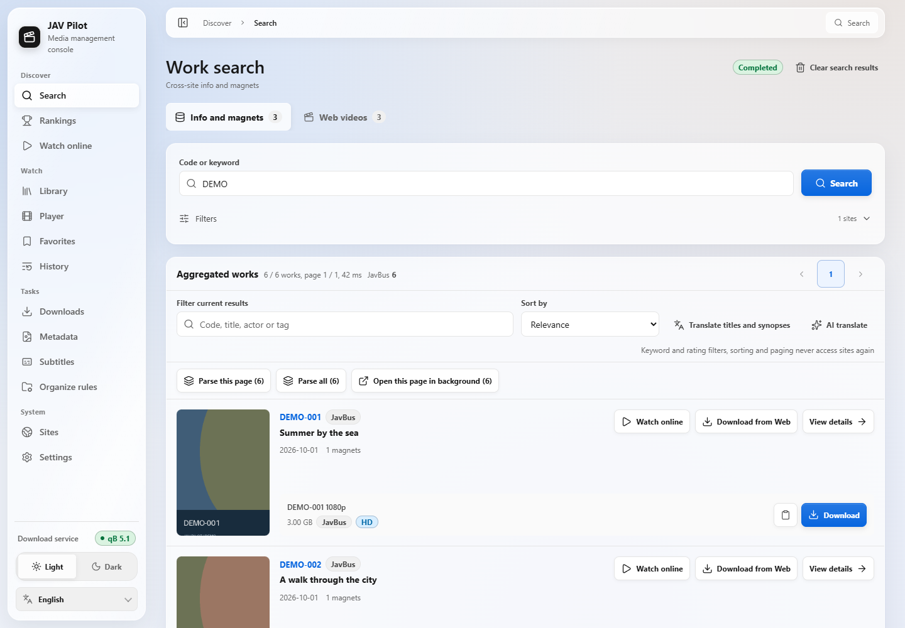
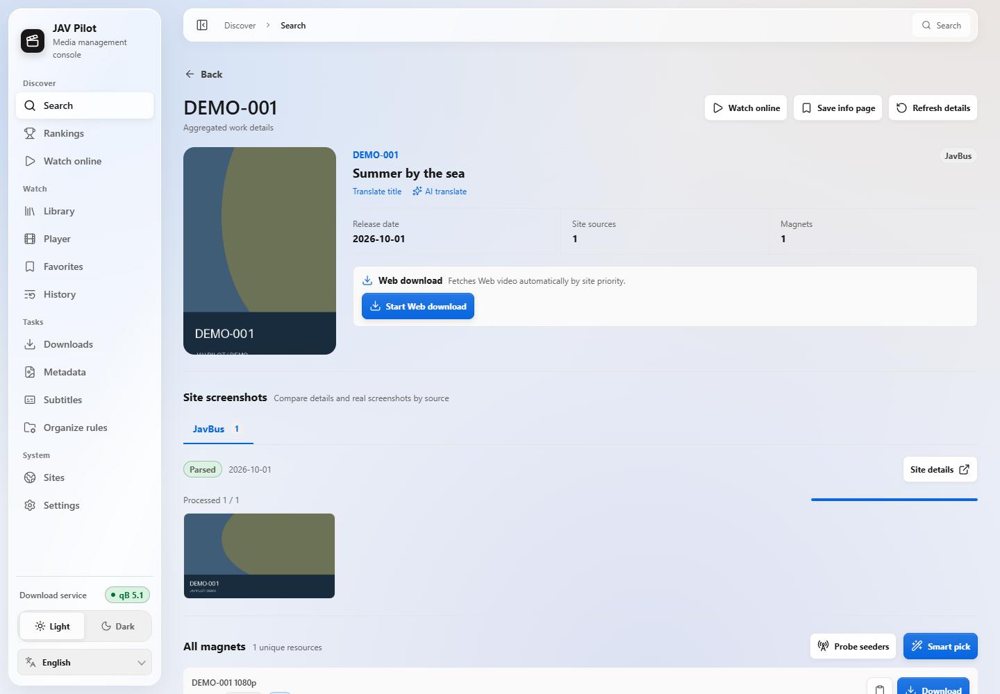
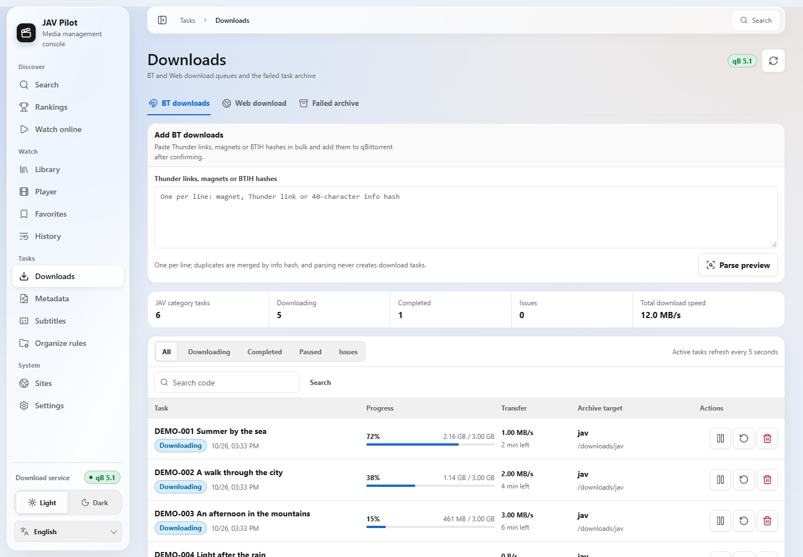
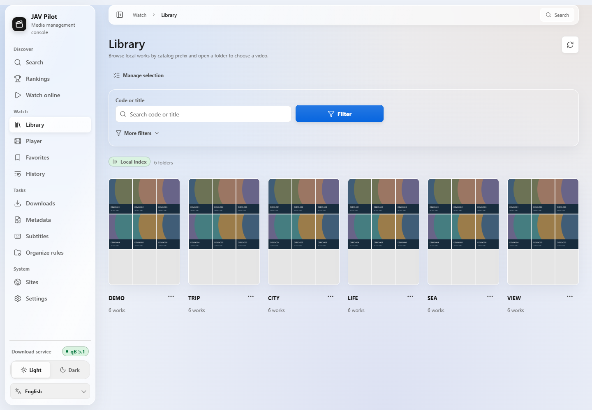
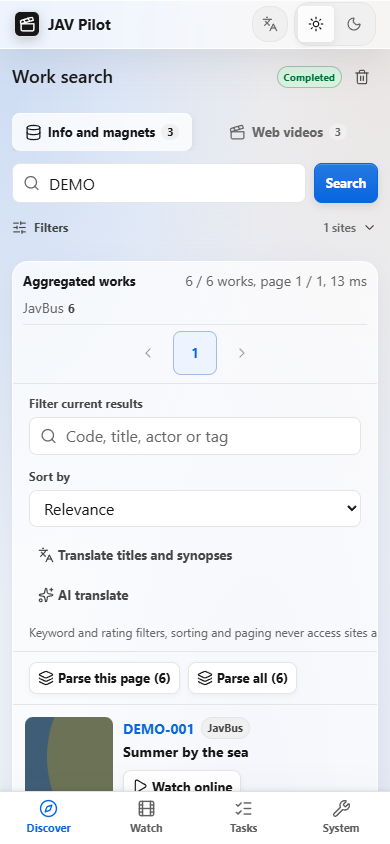
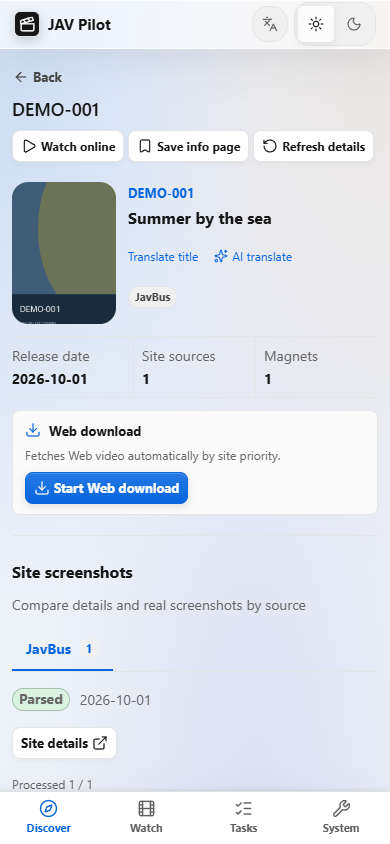
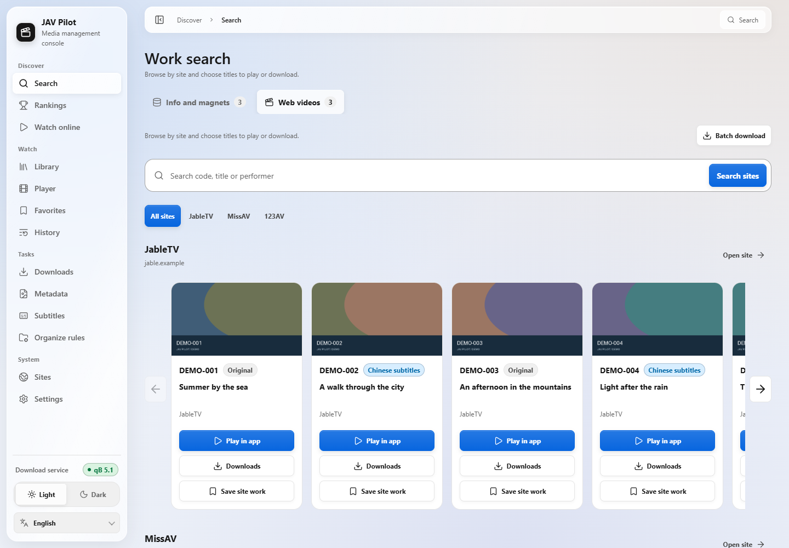
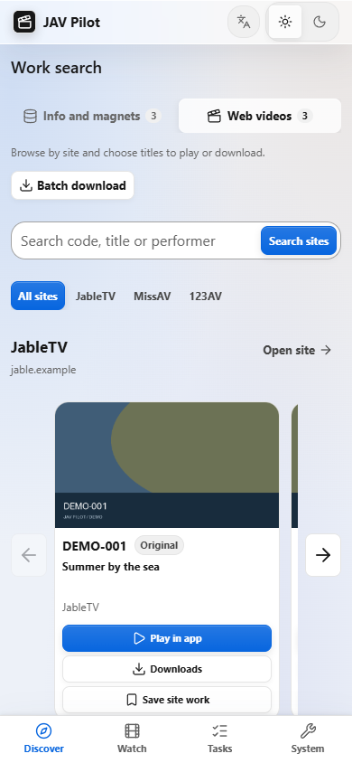
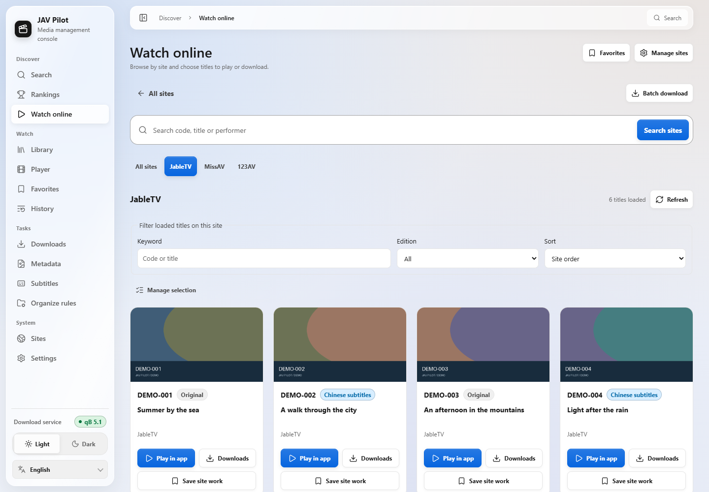
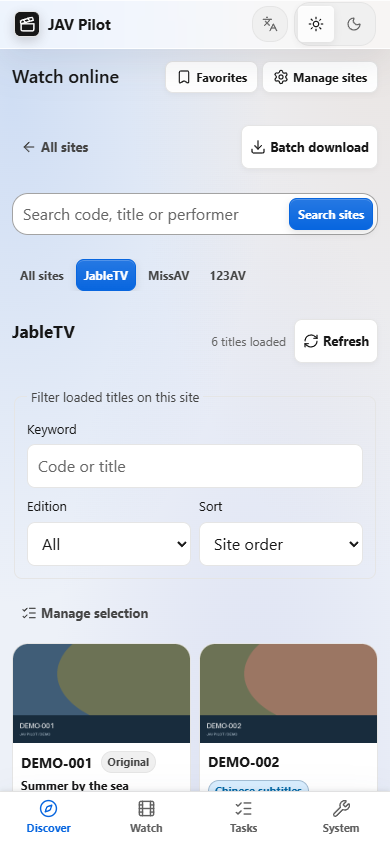

<p align="center">
  
</p>

<div align="center">

<a href="../../README.md">简体中文</a> ｜
<a href="README_zh-TW.md">繁體中文</a> ｜
<a href="README_en.md">English</a> ｜
<b>日本語</b> ｜
<a href="README_fr.md">Français</a> ｜
<a href="README_es.md">Español</a> ｜
<a href="README_ru.md">Русский</a> ｜
<a href="README_ar.md">العربية</a>

<a href="https://hub.docker.com/r/drdon1234/jav-pilot"></a>
<a href="https://hub.docker.com/r/drdon1234/jav-pilot"></a>


<a href="../../LICENSE"></a>
<br>

<a href="../guide/getting-started.md">インストール</a> ｜
<a href="../guide/usage.md">使い方</a> ｜
<a href="../guide/faq.md">よくある質問</a> ｜
<a href="../guide/configuration.md">設定</a> ｜
<a href="https://github.com/drdon1234/JAV-Pilot/issues">不具合報告</a>

</div>

<br>

JAV Pilot は NAS、サーバー、PC で運用できるセルフホスト型の動画アプリです。作品検索、オンライン視聴、ダウンロード、ライブラリ整理、続きからの再生を一か所で行えます。整理したライブラリは Jellyfin、Emby、Kodi でも利用可能。PC・スマートフォンのブラウザーに対応し、設定・履歴・動画は自分の機器に保存されます。

> [!NOTE]
> `docs/` 以下の詳細ドキュメントは、現在簡体字中国語のみで提供しています。Web インターフェースは日本語に対応し、既定でブラウザーとシステムの言語に合わせて表示されます。


## ✨ 主な機能

1. 🔍 **作品検索**：品番やキーワードで、作品情報・マグネットリンク・再生可能な動画を探せます。
2. ▶️ **オンライン視聴**：サイト別に検索・絞り込み、スクロールで続きを読み込み、選んだ版をアプリ内で再生します。
3. ⬇️ **ダウンロード管理**：マグネットと動画サイトからのダウンロード、進捗確認、失敗したタスクの管理、重複の防止に対応。
4. 📚 **ライブラリ整理**：既存の動画と新しいダウンロードを管理し、ポスターや作品情報を補完。Jellyfin、Emby、Kodi で利用できます。
5. 🎬 **再生と続きから視聴**：オンライン・ローカルとも字幕、速度変更、全画面、視聴履歴に対応。
6. 💬 **中国語字幕**：字幕を検索・一括取得し、候補の変更、自分の字幕の読み込み、表示とタイミングの調整ができます。
7. ⭐ **お気に入りと発見**：作品や再生入口を保存し、作品・女優・カテゴリのランキングを閲覧できます。
8. 🌐 **タイトル翻訳**：表示言語への翻訳や、自分の AI 翻訳サービスとの接続に対応。
9. 🔔 **通知とサイト確認**：ダウンロード結果、容量不足、サイト障害の通知を受け取り、接続状況を確認できます。
10. 📱 **PC とスマートフォン**：ブラウザーで利用でき、8 言語とライト・ダークテーマに対応。

## 🚀 クイックスタート

インストール方法は 3 種類あります。初めて導入する場合は方法 1 を推奨します。

| 方法 | 適した用途 | 前提条件 |
| --- | --- | --- |
| [方法 1：Docker（推奨）](#方法-1docker-でデプロイ推奨) | NAS、Linux サーバー、または Windows の WSL2 | Docker と Docker Compose v2 |
| [方法 2：ソースからイメージをビルド](#方法-2ソースからイメージをビルド) | ソースを変更する場合、またはイメージを自分でビルドする場合 | Docker、Git |
| [方法 3：Docker を使わない](#方法-3docker-を使わない) | Docker 環境がない場合、またはシステムサービスとして実行する場合 | Git、Python 3.11.5+、Node.js 24 |

### 方法 1：Docker でデプロイ（推奨）

Docker Hub で公開しているイメージを使用します。必要なのは `docker-compose.yml` と `.env` の 2 ファイルだけです。

> [!NOTE]
> イメージは x86_64（amd64）アーキテクチャのみに対応しています。Windows では WSL2 上で以下の手順を実行してください。

**1. Compose ファイルを選ぶ**

各 Compose ファイルがデプロイするサービスは次のとおりです。

| Compose ファイル | デプロイされるサービス |
| --- | --- |
| `docker-compose.yml` | JAV Pilot |
| `deploy/docker-compose.jackett.yml` | JAV Pilot、Jackett |
| `deploy/docker-compose.qbittorrent.yml` | JAV Pilot、qBittorrent |
| `deploy/docker-compose.full.yml` | JAV Pilot、qBittorrent、Jackett |

qBittorrent は BitTorrent クライアント、Jackett は Sukebei・Tokyo Toshokan 用の Torznab インターフェースを提供します。一緒にデプロイされるコンテナの名前は `jav-pilot-qbittorrent` と `jav-pilot-jackett` で、既存の同種のコンテナとは競合しません。

**2. Compose ファイルと設定テンプレートをダウンロードする**

```bash
mkdir jav-pilot && cd jav-pilot
curl -fsSL -o docker-compose.yml https://raw.githubusercontent.com/drdon1234/JAV-Pilot/main/docker-compose.yml
curl -fsSL -o .env https://raw.githubusercontent.com/drdon1234/JAV-Pilot/main/.env.example
```

手順 1 で `deploy/` 以下のファイルを選んだ場合は、2 行目のコマンドの `main/docker-compose.yml` を該当するパス（例：`main/deploy/docker-compose.full.yml`）に置き換えてください。保存するファイル名は `docker-compose.yml` のままです。

**3. `.env` を編集する**

次のコマンドを実行して、セッション鍵を生成し、実行ユーザー（`PUID` / `PGID`）を現在のアカウントに設定します。

```bash
sed -i "s/^JAV_PILOT_AUTH_SECRET=.*/JAV_PILOT_AUTH_SECRET=$(openssl rand -hex 32)/; s/^PUID=.*/PUID=$(id -u)/; s/^PGID=.*/PGID=$(id -g)/" .env
```

続いて `.env` を編集します（例：`nano .env`）。

- `JAV_PILOT_AUTH_PASSWORD`：ログインパスワード。12 文字以上、必須です。
- `QBITTORRENT_PASSWORD`：qBittorrent を一緒にデプロイする場合に設定します。6 文字以上。qBittorrent WebUI のパスワード（ユーザー名 `admin`）になり、JAV Pilot も同じ認証情報で自動接続します。
- ディレクトリ：メディアライブラリの既定の場所は、現在のディレクトリ内の `media/` です。NAS 上の別のディレクトリを使う場合は、`.env` の「目录」（ディレクトリ）セクションを変更してください。

**4. サービスを起動する**

```bash
docker compose up -d
```

初回起動では Chromium と FFmpeg を含むイメージを取得します。サイズと所要時間はリリースとネットワークにより異なります。起動後、ブラウザで `http://<ホストの IP>:8766` を開き、ユーザー名 `admin` と前の手順で設定したパスワードでログインします。

必須の設定が不足している場合は、`docker compose` が該当項目を明示します。その他の問題は[インストールガイド](../guide/getting-started.md#启动失败时)を参照してください。qBittorrent と Jackett の詳細は[インストールガイド](../guide/getting-started.md#同时部署-qbittorrent-或-jackett)と[トレントインデクサー](../guide/indexers.md)にあります。

### 方法 2：ソースからイメージをビルド

イメージをローカルでビルドします。ソースを変更する場合に適しています。イメージの入手元以外の手順は方法 1 と同じです。

```bash
git clone https://github.com/drdon1234/JAV-Pilot.git
cd JAV-Pilot
docker build -t jav-pilot:local .
cp .env.example .env
```

方法 1 の手順 3 に従って `.env` を編集し、`JAV_PILOT_IMAGE` を `jav-pilot:local` に設定してから `docker compose up -d` を実行します。初回のビルドではブラウザと依存パッケージのダウンロード、および FFmpeg のコンパイルを行うため、時間がかかります。

この方法では JAV Pilot のみをデプロイします。qBittorrent や Jackett も一緒にデプロイする場合は、[インストールガイド](../guide/getting-started.md#方式二从源码构建镜像)を参照してください。

### 方法 3：Docker を使わない

JAV Pilot 自体が Web サービスであり、Linux・macOS・Windows 上で直接実行できます。前提条件は Git、Python 3.11.5 以上（3.12 を推奨）、Node.js 24、npm です。Debian / Ubuntu ではさらに `python3-venv` が必要です。Linux / macOS の例：

```bash
git clone https://github.com/drdon1234/JAV-Pilot.git
cd JAV-Pilot
python3 -m venv .venv
. .venv/bin/activate
python -m pip install -e .
python -m playwright install chromium
npm --prefix frontend ci
npm --prefix frontend run build
jav-pilot serve
```

起動後、`http://127.0.0.1:8766` を開きます。既定ではローカルホストのみで待ち受け、ログインは不要です。Windows でのコマンドは[インストール手順](../guide/getting-started.md#安装步骤)を、LAN からのアクセス（ログインの設定が必要）、systemd サービスとしての実行、メディアライブラリのディレクトリ、Web ダウンロードの設定は[インストールガイド](../guide/getting-started.md#方式三不使用-docker)を参照してください。

### 更新

**方法 1**：Compose ファイルがあるディレクトリで実行します。

```bash
docker compose pull
docker compose stop -t 120 jav-pilot
docker compose up -d
```

**方法 2**：リポジトリのディレクトリで実行します。

```bash
git pull
docker build -t jav-pilot:local .
docker compose stop -t 120 jav-pilot
docker compose up -d
```

**方法 3**：リポジトリのディレクトリで実行し、完了後にサービスを再起動します。

```bash
git pull
python -m pip install -e .
npm --prefix frontend ci
npm --prefix frontend run build
```

## 🧭 初期設定

1. **サイトの可用性を確認する**：「サイト → サイト診断」で実在する品番を入力し、「全サイトをテスト」をクリックします。どのサイトにも接続できない場合は、通常プロキシの設定が必要です。[よくある質問](../guide/faq.md#所有站点都连不上)を参照してください。
2. **既存の qBittorrent に接続する**（任意）：一緒にデプロイした qBittorrent は自動で接続済みのため、この手順は不要です。既存の qBittorrent を使う場合は、「設定 → qBittorrent」でアドレスとアカウントを入力します。qBittorrent と JAV Pilot から見えるディレクトリのパスが異なる場合は、[使い方](../guide/usage.md#2-连接-qbittorrent可选)に従ってパスの対応付けを設定してください。
3. **検索とダウンロード**：「検索」で品番を入力して作品の詳細を開き、マグネットリンクの「ダウンロード」または「Web ダウンロードを開始」を選び、「ダウンロード」ページで進行状況を確認します。

詳しい手順は[使い方](../guide/usage.md)を参照してください。

## 🌐 対応ソースと連携

| 種類 | 対応 |
| --- | --- |
| 情報とマグネットリンク | JavBus、JavDB、FC2（既定で有効）、FANZA、MGS、AVBase、FC2DB（「サイト」で有効化可能） |
| トレントインデクサー | Sukebei、Tokyo Toshokan（Jackett 経由。JAV Pilot と一緒にデプロイ可能） |
| 動画ダウンロード | JableTV、MissAV、123AV |
| ランキング | JavDB、FANZA、FC2、MGStage、JavMenu、Netflav、および一本道・カリビアンコムなど無修正メーカーの公式サイト |
| ダウンロードクライアント | qBittorrent |
| メディアサーバー | Jellyfin、Emby、Kodi（NFO・ポスター・背景画像を読み込み） |
| AI 翻訳 | OpenAI と互換 API、Anthropic Claude、Google Gemini、Azure OpenAI、Ollama など |
| 通知 | Webhook、Gotify、Telegram、NAS 通知 |

外部サイトは、デザインの変更、地域によるアクセス制限、ボット対策の認証などが行われることがあります。各サイトが提供する情報と現在の可用性は、[ソース説明](../guide/sources.md)とアプリ内の「サイト → サイト診断」で確認できます。

## 📸 スクリーンショット

<p align="center">
  
  <br>
  <sub>スクリーンショットはすべて架空のサンプルデータを使用しています。</sub>
</p>

<p align="center">
  
  
</p>
<p align="center">
  
  
  
  <br>
  <sub>作品の詳細 · ダウンロードタスク · メディアライブラリ · モバイル</sub>
</p>

<p align="center">
  
  
</p>
<p align="center">
  
  
</p>

## 📖 ドキュメント

ドキュメントは簡体字中国語で書かれています。

| 利用者向け | 開発者向け |
| --- | --- |
| [インストールガイド](../guide/getting-started.md)：インストール方法、ディレクトリ、リモートアクセス | [アーキテクチャ](../guide/architecture.md) |
| [使い方](../guide/usage.md)：サイトの確認からダウンロードと整理まで | [HTTP API](../guide/api.md) |
| [よくある質問](../guide/faq.md) · [設定](../guide/configuration.md) | [開発と検証](../guide/development.md) |
| [ソース説明](../guide/sources.md) · [トレントインデクサー](../guide/indexers.md) | [セキュリティ](../../SECURITY.md) |
| [バックアップと運用](../guide/operations.md) | |

## 🔒 データとプライバシー

設定・履歴・データベースは `data/`、ログイン情報は `.env` に保存されます。公開しないでください。検索、ランキング、字幕、視聴、ダウンロードでは対応するサイトや配信サービスに接続します。翻訳ではタイトルを翻訳サービスへ、通知では内容を設定した宛先へ送信します。設定画面で関連機能を管理できます。

## ⚖️ 免責事項

JAV Pilot はツールソフトウェアであり、動画・アカウント・リソースは一切提供しません。また、特定のコンテンツを検索またはダウンロードできることも保証しません。取得する権利のあるコンテンツのみをダウンロードし、居住地の法令および各サイトの利用規約を遵守してください。

## 📄 ライセンス

コードは [MIT License](../../LICENSE) で公開しています。このライセンスは、第三者の動画・画像・サイトの情報・商標の使用権を付与するものではありません。

## 💬 フィードバックとサポート

不具合や要望は [Issues](https://github.com/drdon1234/JAV-Pilot/issues) からお寄せください。Star による応援も歓迎します。
