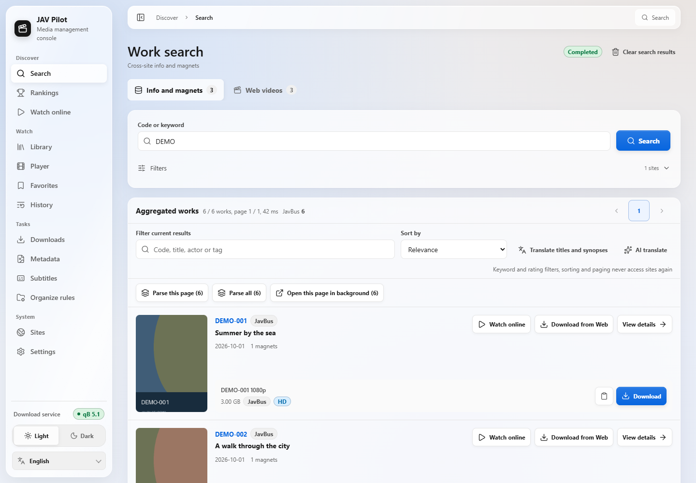
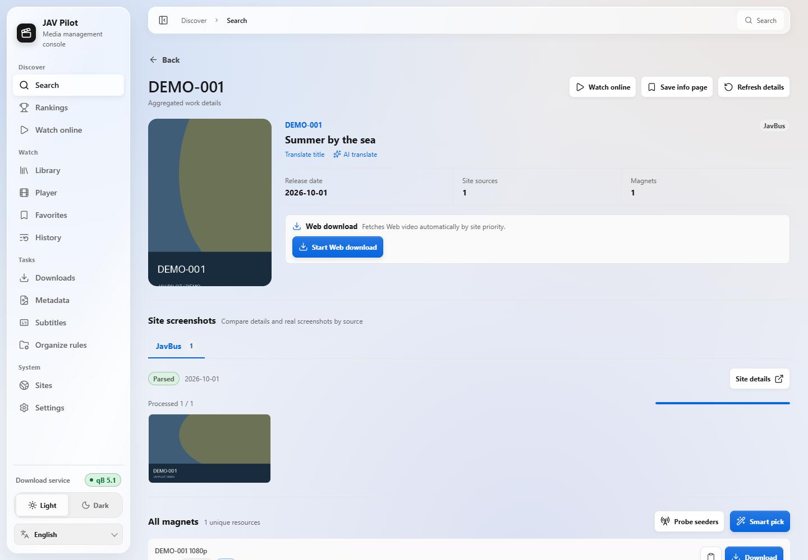
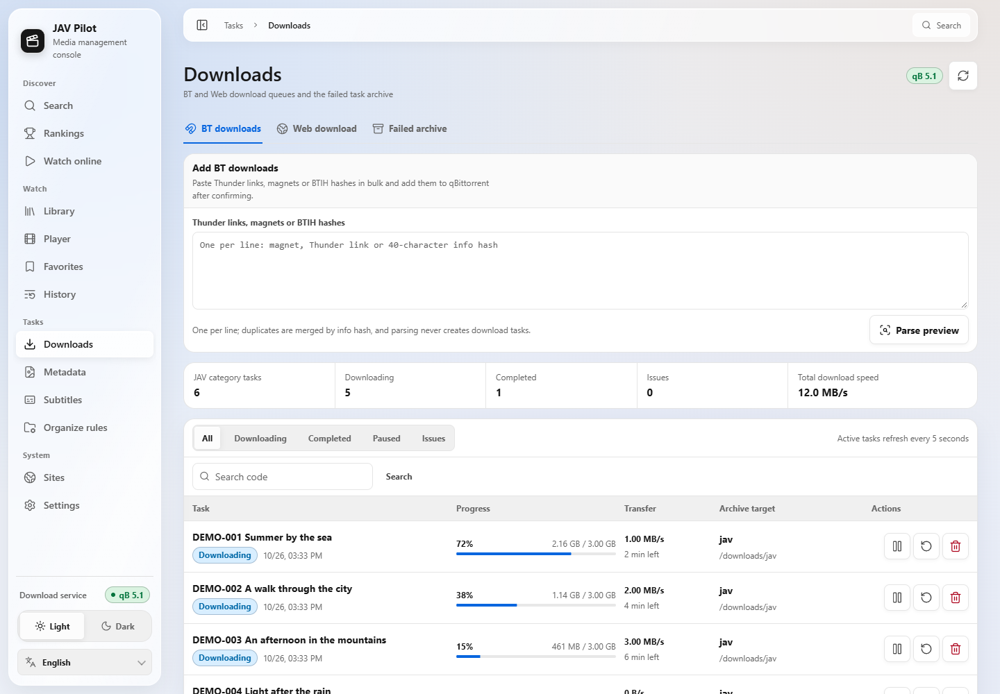
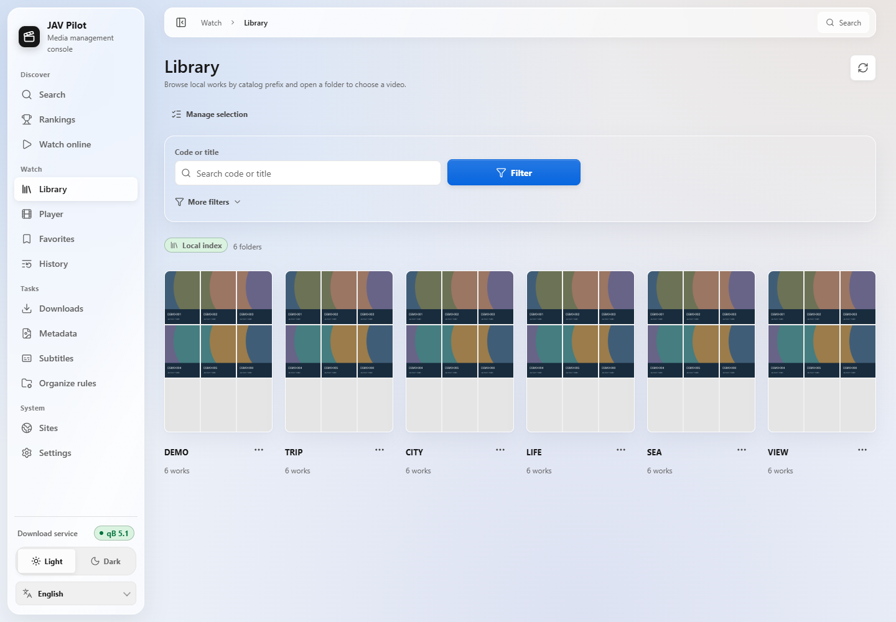
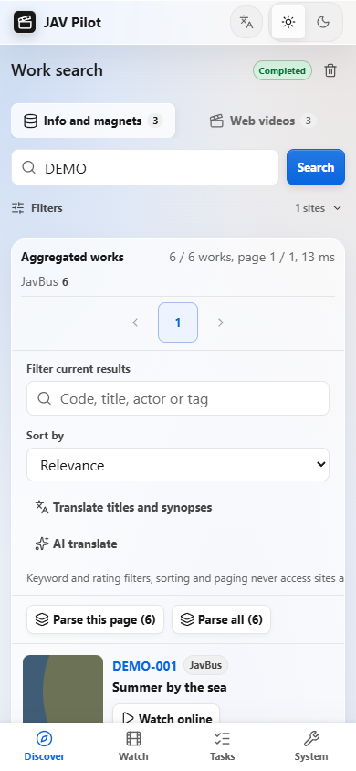
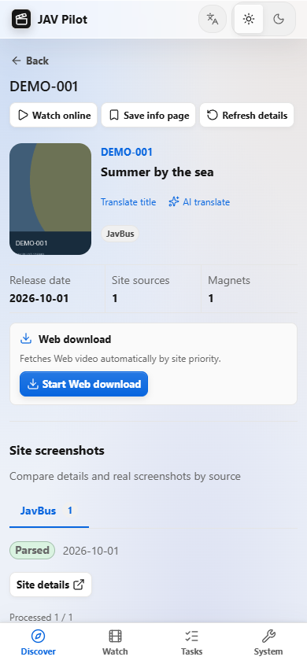
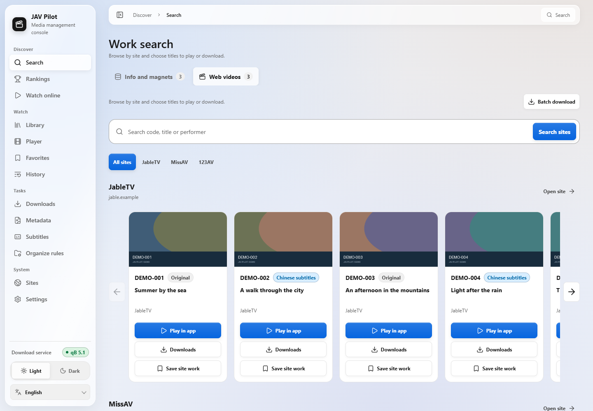
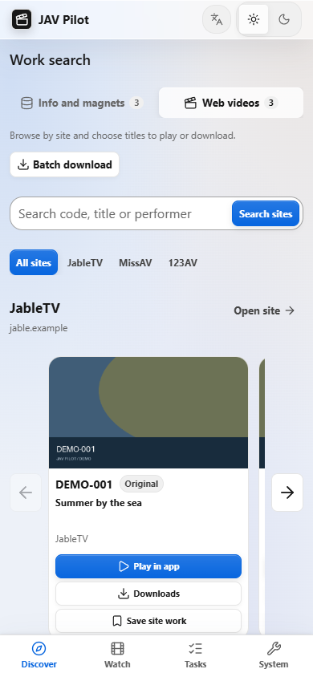
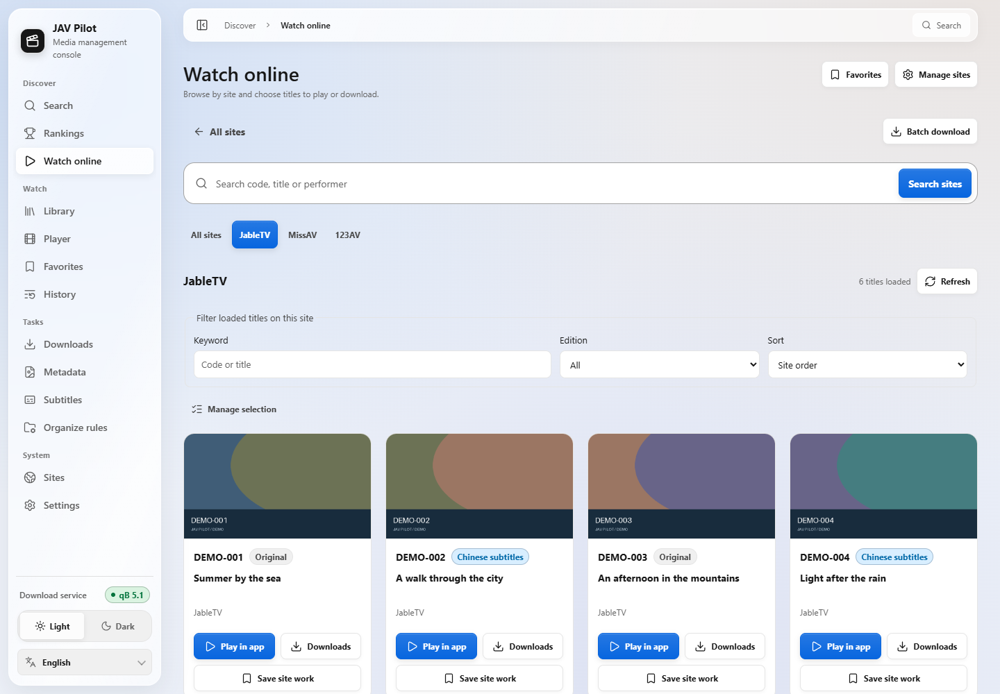
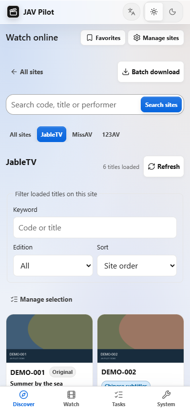

<p align="center">
  
</p>

<div align="center">

<a href="../../README.md">简体中文</a> |
<a href="README_zh-TW.md">繁體中文</a> |
<a href="README_en.md">English</a> |
<a href="README_ja.md">日本語</a> |
<a href="README_fr.md">Français</a> |
<a href="README_es.md">Español</a> |
<b>Русский</b> |
<a href="README_ar.md">العربية</a>

<a href="https://hub.docker.com/r/drdon1234/jav-pilot"></a>
<a href="https://hub.docker.com/r/drdon1234/jav-pilot"></a>


<a href="../../LICENSE"></a>
<br>

<a href="../guide/getting-started.md">Установка</a> |
<a href="../guide/usage.md">Использование</a> |
<a href="../guide/faq.md">Вопросы и ответы</a> |
<a href="../guide/configuration.md">Настройка</a> |
<a href="https://github.com/drdon1234/JAV-Pilot/issues">Сообщить о проблеме</a>

</div>

<br>

JAV Pilot — видеоприложение для самостоятельного размещения на NAS, сервере или ПК. Ищите, смотрите онлайн, скачивайте, организуйте медиатеку и продолжайте просмотр в одном месте. Подготовленная библиотека работает также с Jellyfin, Emby и Kodi. Доступно в браузере компьютера и телефона; настройки, история и файлы хранятся на вашем устройстве.

> [!NOTE]
> Подробная документация в каталоге `docs/` пока доступна только на упрощённом китайском языке. Веб-интерфейс доступен на русском и по умолчанию следует языку браузера и системы.


## ✨ Возможности

1. 🔍 **Поиск видео**: Находите сведения, magnet-ссылки и онлайн-видео по коду или ключевым словам.
2. ▶️ **Онлайн-просмотр**: Просматривайте и фильтруйте результаты по сайтам, загружайте продолжение прокруткой и смотрите выбранную версию в приложении.
3. ⬇️ **Управление загрузками**: Загружайте через magnet или видеосайты, следите за прогрессом, управляйте ошибками и избегайте повторных загрузок.
4. 📚 **Организация медиатеки**: Управляйте файлами и новыми загрузками, дополняйте постеры и метаданные для Jellyfin, Emby и Kodi.
5. 🎬 **Воспроизведение и продолжение**: Субтитры, скорость, полный экран и история доступны для локального и онлайн-просмотра.
6. 💬 **Китайские субтитры**: Ищите и загружайте субтитры пакетно, выбирайте другой вариант, импортируйте свои файлы, настраивайте вид и синхронизацию.
7. ⭐ **Избранное и рекомендации**: Сохраняйте закладки и просматривайте рейтинги произведений, актрис и категорий.
8. 🌐 **Перевод названий**: Переводите названия на язык интерфейса или подключайте свой сервис ИИ-перевода.
9. 🔔 **Уведомления и проверка сайтов**: Получайте результаты загрузок, предупреждения о нехватке места и недоступности источников.
10. 📱 **Компьютер и телефон**: Адаптивный интерфейс, восемь языков, светлая и тёмная темы.

## 🚀 Быстрый старт

Доступны три способа установки. Для первого развёртывания рекомендуется способ 1.

| Способ | Сценарий | Требования |
| --- | --- | --- |
| [Способ 1: Docker (рекомендуется)](#способ-1-развёртывание-в-docker-рекомендуется) | NAS, Linux-сервер или WSL2 в Windows | Docker и Docker Compose v2 |
| [Способ 2: сборка из исходного кода](#способ-2-сборка-образа-из-исходного-кода) | Изменение исходного кода или сборка собственного образа | Docker, Git |
| [Способ 3: без Docker](#способ-3-без-docker) | Docker недоступен или нужен запуск в виде системной службы | Git, Python 3.11+, Node.js 24 |

### Способ 1: развёртывание в Docker (рекомендуется)

Используется образ, опубликованный на Docker Hub. Нужны только файлы `docker-compose.yml` и `.env`.

> [!NOTE]
> Образ поддерживает только архитектуру x86_64 (amd64). В Windows выполняйте следующие шаги в WSL2.

**1. Выберите файл Compose**

Каждый файл Compose разворачивает следующие сервисы:

| Файл Compose | Развёртываемые сервисы |
| --- | --- |
| `docker-compose.yml` | JAV Pilot |
| `deploy/docker-compose.jackett.yml` | JAV Pilot, Jackett |
| `deploy/docker-compose.qbittorrent.yml` | JAV Pilot, qBittorrent |
| `deploy/docker-compose.full.yml` | JAV Pilot, qBittorrent, Jackett |

qBittorrent — BitTorrent-клиент, Jackett предоставляет интерфейс Torznab для Sukebei и Tokyo Toshokan. Контейнеры, развёртываемые вместе с JAV Pilot, называются `jav-pilot-qbittorrent` и `jav-pilot-jackett` и не конфликтуют с уже существующими контейнерами того же типа.

**2. Загрузите файл Compose и шаблон настроек**

```bash
mkdir jav-pilot && cd jav-pilot
curl -fsSL -o docker-compose.yml https://raw.githubusercontent.com/drdon1234/JAV-Pilot/main/docker-compose.yml
curl -fsSL -o .env https://raw.githubusercontent.com/drdon1234/JAV-Pilot/main/.env.example
```

Если на шаге 1 выбран файл из каталога `deploy/`, замените `main/docker-compose.yml` во второй команде на его путь (например, `main/deploy/docker-compose.full.yml`). Сохранённый файл по-прежнему должен называться `docker-compose.yml`.

**3. Заполните `.env`**

Выполните следующую команду, чтобы создать ключ сеанса и указать текущую учётную запись в качестве пользователя, от имени которого работает служба (`PUID` / `PGID`):

```bash
sed -i "s/^JAV_PILOT_AUTH_SECRET=.*/JAV_PILOT_AUTH_SECRET=$(openssl rand -hex 32)/; s/^PUID=.*/PUID=$(id -u)/; s/^PGID=.*/PGID=$(id -g)/" .env
```

Затем отредактируйте `.env` (например, командой `nano .env`):

- `JAV_PILOT_AUTH_PASSWORD`: пароль для входа, не менее 12 символов. Обязательный параметр.
- `QBITTORRENT_PASSWORD`: задаётся, если qBittorrent развёртывается вместе с JAV Pilot; не менее 6 символов. Он становится паролем веб-интерфейса qBittorrent (пользователь `admin`), и JAV Pilot автоматически подключается с теми же учётными данными.
- Каталоги: по умолчанию медиатека находится в `media/` текущего каталога. Чтобы использовать другой каталог на NAS, измените раздел «目录» (Каталоги) в `.env`.

**4. Запустите службу**

```bash
docker compose up -d
```

При первом запуске загружается образ с Chromium и FFmpeg; размер и время загрузки зависят от версии и сети. Затем откройте в браузере `http://<IP хоста>:8766` и войдите под пользователем `admin` с паролем, заданным на предыдущем шаге.

Если обязательный параметр не задан, `docker compose` сообщит об этом явно. О других проблемах см. [руководство по установке](../guide/getting-started.md#启动失败时). Подробнее о qBittorrent и Jackett — в [руководстве по установке](../guide/getting-started.md#同时部署-qbittorrent-或-jackett) и в разделе [торрент-индексаторы](../guide/indexers.md).

### Способ 2: сборка образа из исходного кода

Образ собирается локально — это нужно, если требуется изменить исходный код. Все шаги, кроме получения образа, совпадают со способом 1.

```bash
git clone https://github.com/drdon1234/JAV-Pilot.git
cd JAV-Pilot
docker build -t jav-pilot:local .
cp .env.example .env
```

Заполните `.env`, как на шаге 3 способа 1, задайте `JAV_PILOT_IMAGE=jav-pilot:local` и выполните `docker compose up -d`. Первая сборка загружает браузер и зависимости и компилирует FFmpeg, поэтому занимает некоторое время.

Этот способ развёртывает только JAV Pilot. Чтобы развернуть также qBittorrent или Jackett, см. [руководство по установке](../guide/getting-started.md#方式二从源码构建镜像).

### Способ 3: без Docker

JAV Pilot сам по себе является веб-службой и запускается непосредственно в Linux, macOS или Windows. Требования: Git, Python 3.11 или новее (рекомендуется 3.12), Node.js 24 и npm; в Debian / Ubuntu дополнительно нужен `python3-venv`. В Linux / macOS:

```bash
git clone https://github.com/drdon1234/JAV-Pilot.git
cd JAV-Pilot
python3 -m venv .venv
. .venv/bin/activate
python -m pip install -e .
python -m playwright install chromium
npm --prefix frontend ci
npm --prefix frontend run build
jav-pilot serve
```

Затем откройте `http://127.0.0.1:8766`. По умолчанию служба принимает подключения только с локального компьютера и не требует входа. Команды для Windows см. в разделе [шаги установки](../guide/getting-started.md#安装步骤); доступ из локальной сети (требуется настроить вход), запуск в виде службы systemd, каталог медиатеки и веб-загрузка описаны в [руководстве по установке](../guide/getting-started.md#方式三不使用-docker).

### Обновление

**Способ 1**: выполнить в каталоге с файлом Compose

```bash
docker compose pull
docker compose stop -t 120 jav-pilot
docker compose up -d
```

**Способ 2**: выполнить в каталоге репозитория

```bash
git pull
docker build -t jav-pilot:local .
docker compose stop -t 120 jav-pilot
docker compose up -d
```

**Способ 3**: выполнить в каталоге репозитория, затем перезапустить службу

```bash
git pull
python -m pip install -e .
npm --prefix frontend ci
npm --prefix frontend run build
```

## 🧭 Начальная настройка

1. **Проверьте доступность сайтов**: в разделе «Сайты → Диагностика сайтов» введите существующий код каталога и нажмите «Проверить все сайты». Если ни один сайт недоступен, обычно требуется настроить прокси; см. [вопросы и ответы](../guide/faq.md#所有站点都连不上).
2. **Подключите существующий qBittorrent** (необязательно): qBittorrent, развёрнутый вместе с JAV Pilot, уже подключён, и этот шаг можно пропустить. Для существующего qBittorrent укажите его адрес и учётную запись в разделе «Настройки → qBittorrent». Если qBittorrent и JAV Pilot видят разные пути к каталогам, настройте сопоставление путей согласно [руководству по использованию](../guide/usage.md#2-连接-qbittorrent可选).
3. **Поиск и загрузка**: введите код каталога в разделе «Поиск», откройте карточку работы, выберите «Скачать» для magnet-ссылки или «Начать Web-загрузку» и следите за ходом на странице «Загрузки».

Полное описание приведено в [руководстве по использованию](../guide/usage.md).

## 🌐 Поддерживаемые источники и интеграции

| Категория | Поддержка |
| --- | --- |
| Метаданные и magnet-ссылки | JavBus, JavDB, FC2 (включены по умолчанию); FANZA, MGS, AVBase, FC2DB (включаются в разделе «Сайты») |
| Торрент-индексаторы | Sukebei, Tokyo Toshokan (через Jackett, который можно развернуть вместе с JAV Pilot) |
| Загрузка видео | JableTV, MissAV, 123AV |
| Рейтинги | JavDB, FANZA, FC2, MGStage, JavMenu, Netflav, а также официальные сайты студий без цензуры, например 1Pondo и Caribbeancom |
| Клиент загрузки | qBittorrent |
| Медиасерверы | Jellyfin, Emby, Kodi (читают NFO, постеры и фоновые изображения) |
| ИИ-перевод | OpenAI и совместимые API, Anthropic Claude, Google Gemini, Azure OpenAI, Ollama и другие |
| Уведомления | Webhook, Gotify, Telegram, уведомления NAS |

Внешние сайты могут менять структуру, ограничивать доступ по региону или требовать проверку на бота. Какие данные предоставляет каждый сайт и доступен ли он сейчас, см. в [описании источников](../guide/sources.md) и в разделе «Сайты → Диагностика сайтов» приложения.

## 📸 Снимки экрана

<p align="center">
  
  <br>
  <sub>На всех снимках экрана используются вымышленные демонстрационные данные.</sub>
</p>

<p align="center">
  
  
</p>
<p align="center">
  
  
  
  <br>
  <sub>Карточка работы · Задачи загрузки · Медиатека · Мобильная версия</sub>
</p>

<p align="center">
  
  
</p>
<p align="center">
  
  
</p>

## 📖 Документация

Документация написана на упрощённом китайском языке.

| Использование | Разработка |
| --- | --- |
| [Руководство по установке](../guide/getting-started.md): способы установки, каталоги и удалённый доступ | [Архитектура](../guide/architecture.md) |
| [Руководство по использованию](../guide/usage.md): от проверки сайтов до загрузки и организации | [HTTP API](../guide/api.md) |
| [Вопросы и ответы](../guide/faq.md) · [Настройка](../guide/configuration.md) | [Разработка и проверка](../guide/development.md) |
| [Источники](../guide/sources.md) · [Торрент-индексаторы](../guide/indexers.md) | [Безопасность](../../SECURITY.md) |
| [Резервное копирование и эксплуатация](../guide/operations.md) | |

## 🔒 Данные и конфиденциальность

Настройки, история и базы хранятся в `data/`, данные входа — в `.env`; не публикуйте их. Поиск, рейтинги, субтитры, просмотр и загрузки обращаются к соответствующим сайтам и медиасервисам. Перевод отправляет названия выбранному сервису, уведомления — настроенным получателям. Управляйте этими функциями в настройках.

## ⚖️ Отказ от ответственности

JAV Pilot — программный инструмент. Он не предоставляет видео, учётные записи или иные ресурсы и не гарантирует, что конкретный контент удастся найти или загрузить. Загружайте только тот контент, на получение которого у вас есть право, и соблюдайте местное законодательство и условия использования каждого сайта.

## 📄 Лицензия

Код распространяется по [лицензии MIT](../../LICENSE). Лицензия не предоставляет никаких прав на видео, изображения, данные сайтов или товарные знаки третьих лиц.

## 💬 Обратная связь и поддержка

Сообщайте о проблемах и предложениях через [Issues](https://github.com/drdon1234/JAV-Pilot/issues). Звёзды репозиторию приветствуются.
