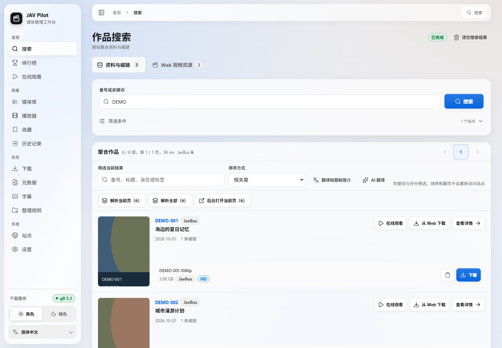
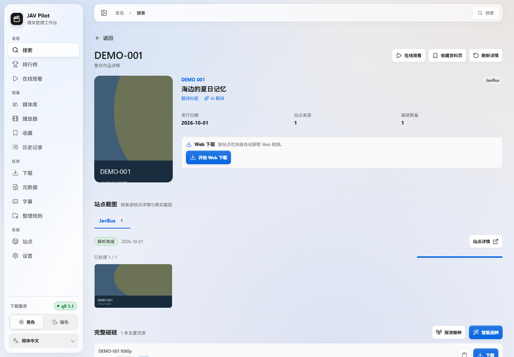
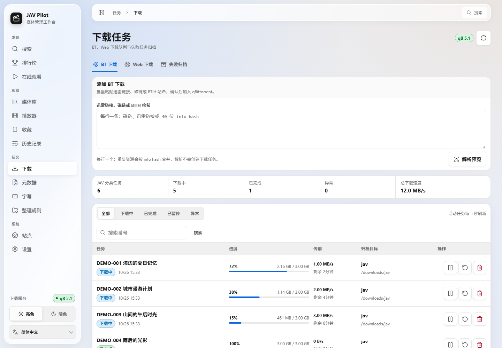
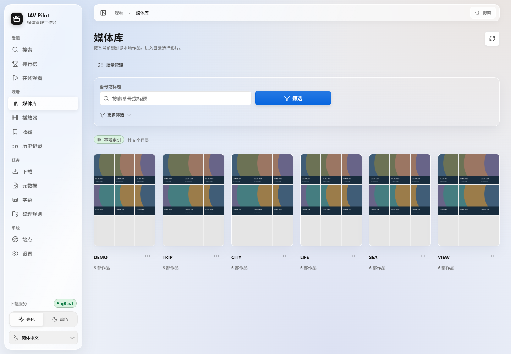
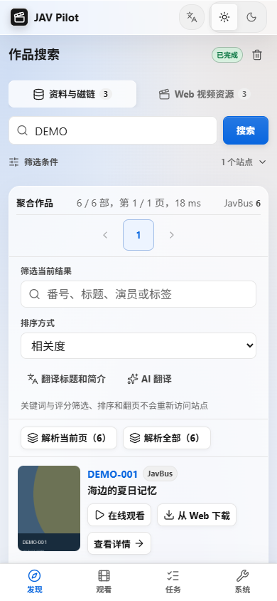
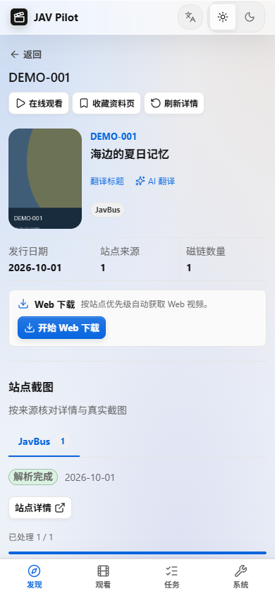
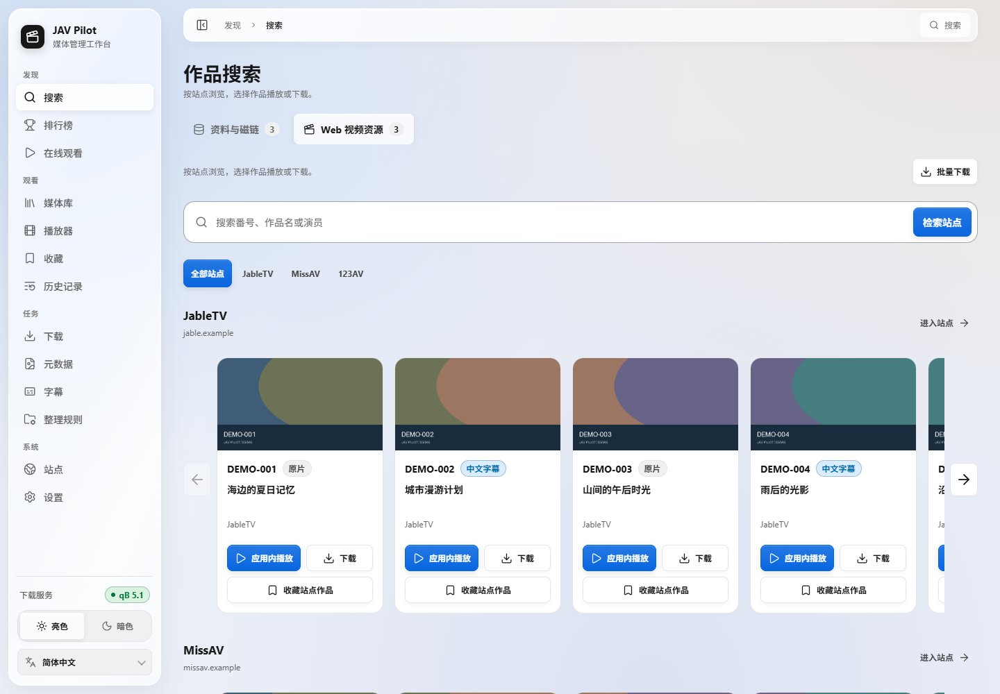
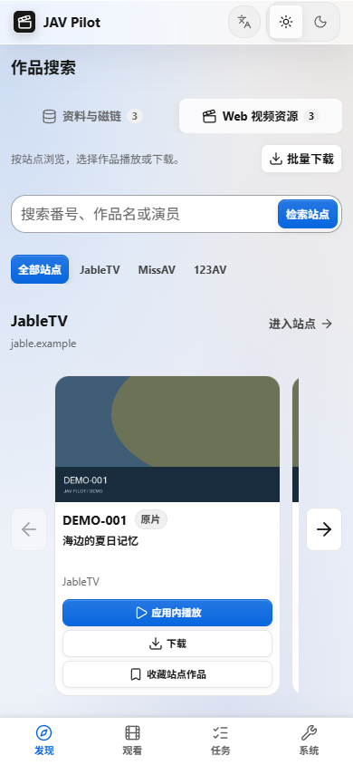
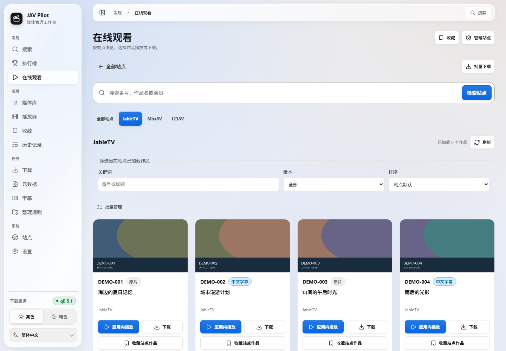
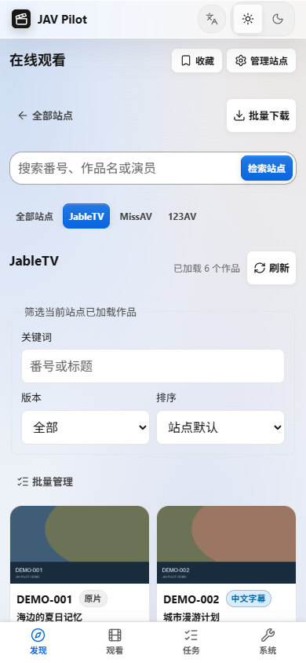

<p align="center">
  
</p>

<div align="center">

<a href="../../README.md">简体中文</a> ｜
<b>繁體中文</b> ｜
<a href="README_en.md">English</a> ｜
<a href="README_ja.md">日本語</a> ｜
<a href="README_fr.md">Français</a> ｜
<a href="README_es.md">Español</a> ｜
<a href="README_ru.md">Русский</a> ｜
<a href="README_ar.md">العربية</a>

<a href="https://hub.docker.com/r/drdon1234/jav-pilot"></a>
<a href="https://hub.docker.com/r/drdon1234/jav-pilot"></a>


<a href="../../LICENSE"></a>
<br>

<a href="../guide/getting-started.md">安裝指南</a> ｜
<a href="../guide/usage.md">使用指南</a> ｜
<a href="../guide/faq.md">常見問題</a> ｜
<a href="../guide/configuration.md">設定</a> ｜
<a href="https://github.com/drdon1234/JAV-Pilot/issues">問題回報</a>

</div>

<br>

JAV Pilot 是可部署於 NAS、伺服器或個人電腦的自架影片管理應用。你可以搜尋作品、線上觀看、下載、整理媒體庫並繼續上次觀看，整理後的媒體庫也可交由 Jellyfin、Emby 或 Kodi 使用。支援電腦與手機瀏覽器，設定、紀錄與影片保存在自己的裝置。

> [!NOTE]
> `docs/` 下的詳細文件目前僅提供簡體中文版本；網頁介面支援繁體中文，預設跟隨瀏覽器與系統語言。


## ✨ 主要功能

1. 🔍 **搜尋影片**：依番號或關鍵字尋找作品，集中查看資料、磁力連結與可播放的影片來源。
2. ▶️ **線上觀看**：依站點瀏覽、搜尋與篩選作品，隨捲動載入更多，選擇版本後直接播放。
3. ⬇️ **下載與查重**：支援磁力連結及影片站下載，查看進度、管理失敗任務，避免重複下載。
4. 📚 **整理媒體庫**：管理既有影片與新下載內容，補齊海報及資料，供 Jellyfin、Emby、Kodi 識別。
5. 🎬 **播放與續播**：線上與本機播放支援字幕、倍速、全螢幕與觀看紀錄。
6. 💬 **中文字幕**：自動尋找或批次補充字幕，也可更換候選、匯入字幕並調整外觀與時間。
7. ⭐ **收藏與探索**：收藏作品和播放入口，透過作品、女優與分類排行榜探索內容。
8. 🌐 **標題翻譯**：將標題翻譯成介面語言，或連接自己的 AI 翻譯服務。
9. 🔔 **通知與站點檢查**：接收下載結果、空間不足與站點異常通知，檢查來源可用性。
10. 📱 **電腦與手機**：適配桌面及行動瀏覽器，提供八種介面語言與淺色、深色主題。

## 🚀 快速開始

提供三種安裝方式，首次部署建議採用方式一。

| 方式 | 適用情境 | 前置條件 |
| --- | --- | --- |
| [一：Docker 部署（建議）](#方式一docker-部署建議) | NAS、Linux 伺服器，或 Windows 下的 WSL2 | Docker 與 Docker Compose v2 |
| [二：從原始碼建置映像檔](#方式二從原始碼建置映像檔) | 需要修改原始碼或自行建置映像檔 | Docker、Git |
| [三：不使用 Docker](#方式三不使用-docker) | 沒有 Docker 環境，或需要以系統服務方式執行 | Git、Python 3.11+、Node.js 24 |

### 方式一：Docker 部署（建議）

使用 Docker Hub 上發佈的映像檔，只需要一個 `docker-compose.yml` 與一個 `.env` 檔案。

> [!NOTE]
> 映像檔僅支援 x86_64（amd64）架構。Windows 使用者請在 WSL2 中執行以下步驟。

**1. 選擇設定檔**

各設定檔部署的服務如下：

| 設定檔 | 部署的服務 |
| --- | --- |
| `docker-compose.yml` | JAV Pilot |
| `deploy/docker-compose.jackett.yml` | JAV Pilot、Jackett |
| `deploy/docker-compose.qbittorrent.yml` | JAV Pilot、qBittorrent |
| `deploy/docker-compose.full.yml` | JAV Pilot、qBittorrent、Jackett |

qBittorrent 為 BT 下載器，Jackett 為 Sukebei、Tokyo Toshokan 提供 Torznab 介面。一同部署的容器分別命名為 `jav-pilot-qbittorrent` 與 `jav-pilot-jackett`，不會與既有的同類容器衝突。

**2. 下載設定檔與設定範本**

```bash
mkdir jav-pilot && cd jav-pilot
curl -fsSL -o docker-compose.yml https://raw.githubusercontent.com/drdon1234/JAV-Pilot/main/docker-compose.yml
curl -fsSL -o .env https://raw.githubusercontent.com/drdon1234/JAV-Pilot/main/.env.example
```

如果第 1 步選擇的是 `deploy/` 下的檔案，請將第二行指令中的 `main/docker-compose.yml` 替換為對應路徑（例如 `main/deploy/docker-compose.full.yml`），儲存的檔名仍為 `docker-compose.yml`。

**3. 填寫 `.env`**

執行以下指令，產生工作階段金鑰，並將執行身分（`PUID` / `PGID`）設為目前帳號：

```bash
sed -i "s/^JAV_PILOT_AUTH_SECRET=.*/JAV_PILOT_AUTH_SECRET=$(openssl rand -hex 32)/; s/^PUID=.*/PUID=$(id -u)/; s/^PGID=.*/PGID=$(id -g)/" .env
```

接著編輯 `.env`（例如 `nano .env`）：

- `JAV_PILOT_AUTH_PASSWORD`：登入密碼，至少 12 個字元，必填。
- `QBITTORRENT_PASSWORD`：一同部署 qBittorrent 時填寫，至少 6 個字元。此密碼將作為 qBittorrent WebUI 的密碼（使用者名稱 `admin`），JAV Pilot 使用同一組憑證自動連線。
- 目錄：媒體庫預設位於目前目錄下的 `media/`。如需使用 NAS 上的其他目錄，請修改 `.env` 中的「目录」區段。

**4. 啟動服務**

```bash
docker compose up -d
```

首次啟動需要下載包含 Chromium 和 FFmpeg 的映像檔，大小與時間依版本和網路而定。啟動完成後，以瀏覽器開啟 `http://<主機 IP>:8766`，使用使用者名稱 `admin` 與上一步設定的密碼登入。

缺少必填設定時，`docker compose` 會明確提示；其他問題請參閱[安裝指南](../guide/getting-started.md#启动失败时)。qBittorrent 與 Jackett 的詳細說明見[安裝指南](../guide/getting-started.md#同时部署-qbittorrent-或-jackett)與[種子索引](../guide/indexers.md)。

### 方式二：從原始碼建置映像檔

在本機建置映像檔，適用於需要修改原始碼的情境。除映像檔來源外，其餘步驟與方式一相同。

```bash
git clone https://github.com/drdon1234/JAV-Pilot.git
cd JAV-Pilot
docker build -t jav-pilot:local .
cp .env.example .env
```

依方式一第 3 步填寫 `.env`，並將其中的 `JAV_PILOT_IMAGE` 設為 `jav-pilot:local`，然後執行 `docker compose up -d`。首次建置需要下載瀏覽器與相依套件並編譯 FFmpeg，耗時較長。

此方式預設僅部署 JAV Pilot。如需同時部署 qBittorrent 或 Jackett，請參閱[安裝指南](../guide/getting-started.md#方式二从源码构建镜像)。

### 方式三：不使用 Docker

JAV Pilot 本身即為 Web 服務，可直接在 Linux、macOS 或 Windows 上執行。前置條件為 Git、Python 3.11 以上（建議 3.12）、Node.js 24 與 npm；Debian / Ubuntu 另需安裝 `python3-venv`。以 Linux / macOS 為例：

```bash
git clone https://github.com/drdon1234/JAV-Pilot.git
cd JAV-Pilot
python3 -m venv .venv
. .venv/bin/activate
python -m pip install -e .
python -m playwright install chromium
npm --prefix frontend ci
npm --prefix frontend run build
jav-pilot serve
```

啟動後開啟 `http://127.0.0.1:8766`。預設僅監聽本機，無需登入。Windows 下的指令請參閱[安裝步驟](../guide/getting-started.md#安装步骤)；區域網路存取（需設定登入）、以 systemd 服務執行、媒體庫目錄與 Web 下載的設定，請參閱[安裝指南](../guide/getting-started.md#方式三不使用-docker)。

### 更新

**方式一**：在設定檔所在目錄執行

```bash
docker compose pull
docker compose stop -t 120 jav-pilot
docker compose up -d
```

**方式二**：在儲存庫目錄執行

```bash
git pull
docker build -t jav-pilot:local .
docker compose stop -t 120 jav-pilot
docker compose up -d
```

**方式三**：在儲存庫目錄執行，完成後重新啟動服務

```bash
git pull
python -m pip install -e .
npm --prefix frontend ci
npm --prefix frontend run build
```

## 🧭 初始設定

1. **檢查站點可用性**：在「站點 → 站點診斷」中填入一個確定存在的番號，點選「測試全部站點」。如果所有站點都無法連線，通常需要設定代理伺服器，請參閱[常見問題](../guide/faq.md#所有站点都连不上)。
2. **連接既有的 qBittorrent**（選用）：一同部署的 qBittorrent 已自動連線，可略過此步。使用既有的 qBittorrent 時，在「設定 → qBittorrent」中填入位址與帳號；如果 qBittorrent 與 JAV Pilot 看到的目錄路徑不一致，請依[使用指南](../guide/usage.md#2-连接-qbittorrent可选)設定路徑對應。
3. **搜尋與下載**：在「搜尋」中輸入番號並開啟作品詳細資料，選擇磁力連結的「下載」或「開始 Web 下載」，然後在「下載」頁面查看進度。

完整說明請參閱[使用指南](../guide/usage.md)。

## 🌐 支援的來源與整合

| 類型 | 支援 |
| --- | --- |
| 資料與磁力連結 | JavBus、JavDB、FC2（預設啟用）；FANZA、MGS、AVBase、FC2DB（可在「站點」中啟用） |
| 種子索引 | Sukebei、Tokyo Toshokan（透過 Jackett，可與 JAV Pilot 一同部署） |
| 影片下載 | JableTV、MissAV、123AV |
| 排行榜 | JavDB、FANZA、FC2、MGStage、JavMenu、Netflav，以及一本道、加勒比等無碼廠商官網 |
| 下載器 | qBittorrent |
| 媒體伺服器 | Jellyfin、Emby、Kodi（讀取 NFO、海報與背景圖） |
| AI 翻譯 | OpenAI 及相容介面、Anthropic Claude、Google Gemini、Azure OpenAI、Ollama 等 |
| 通知 | Webhook、Gotify、Telegram、NAS 通知 |

外部網站可能改版、限制存取地區或要求人機驗證。各站點提供的資料與目前可用性，請參閱[來源說明](../guide/sources.md)與應用程式中的「站點 → 站點診斷」。

## 📸 介面

<p align="center">
  
  <br>
  <sub>截圖皆使用虛構的範例資料。</sub>
</p>

<p align="center">
  
  
</p>
<p align="center">
  
  
  
  <br>
  <sub>作品詳細資料 · 下載任務 · 媒體庫 · 行動版</sub>
</p>

<p align="center">
  
  
</p>
<p align="center">
  
  
</p>

## 📖 文件

文件以簡體中文撰寫。

| 使用 | 開發 |
| --- | --- |
| [安裝指南](../guide/getting-started.md)：安裝方式、目錄與遠端存取 | [架構](../guide/architecture.md) |
| [使用指南](../guide/usage.md)：從站點檢查到下載與整理 | [HTTP API](../guide/api.md) |
| [常見問題](../guide/faq.md) · [設定](../guide/configuration.md) | [開發與驗證](../guide/development.md) |
| [來源說明](../guide/sources.md) · [種子索引](../guide/indexers.md) | [安全性說明](../../SECURITY.md) |
| [備份與維運](../guide/operations.md) | |

## 🔒 資料與隱私

設定、紀錄與資料庫儲存在 `data/`，登入憑證在 `.env`，請勿對外分享。搜尋、排行榜、字幕、線上播放與下載會存取對應站點及媒體服務；翻譯會將標題送至所用翻譯服務，通知會傳送至設定的接收服務。可在設定中管理相關功能。

## ⚖️ 免責聲明

JAV Pilot 僅為工具軟體，不提供任何影片、帳號或資源，也不保證能夠檢索或下載特定內容。請僅下載有權取得的內容，並遵守所在地法律及各站點的使用條款。

## 📄 授權條款

程式碼採用 [MIT License](../../LICENSE)。此授權不授予第三方影片、圖片、站點資料或商標的使用權。

## 💬 回饋與支持

問題與建議請透過 [Issues](https://github.com/drdon1234/JAV-Pilot/issues) 提交。歡迎以 Star 支持本專案。
